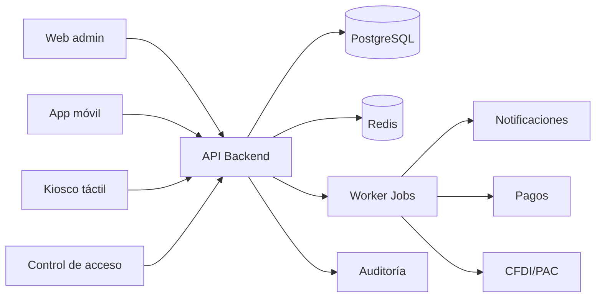

# Arquitectura general

## Visión general

La arquitectura del sistema está diseñada para un gimnasio con operación local crítica: acceso en tiempo real, pagos recurrentes, caja, facturación y reportes. El sistema se separa en 4 capas: usuario, servicios, dominio e infraestructura.

## Componentes principales

### 1. Frontend administrativo
- panel web para dueño, gerente y recepción
- dashboards, gestión de socios y reportes
- acceso segmentado por rol y permisos

### 2. Frontend móvil
- app Expo/React Native para socios (`mobile/`): acceso sin contraseña con código OTP por correo, consulta de perfil, membresía, acceso habilitado y saldo, reserva o cancelación de clases con lista de espera sobre la agenda del club, consulta de rutinas asignadas, entrenamientos (con detalle por serie), medidas y metas, registro de entrenamientos con series (pendientes de revisión del entrenador), de medidas y de metas propias —con cancelación de esas últimas— desde la app, y consulta de pagos de membresía y estado de cuenta
- pendiente: pago en línea, facturas, cobro de clases premium, fotos de progreso desde la app, aprobación de las metas del socio por el entrenador y recordatorios/notificaciones

### 3. Kiosco de recepción
- check-in y flujo de acceso rápido
- consulta del socio
- soporte offline con caché local

### 4. Backend API
- autenticación y autorización
- lógica de negocio y validación
- contratos y integraciones con pagos, PAC y comunicaciones

### 5. Capas de datos e infraestructura
- PostgreSQL para transacciones y almacenamiento histórico
- Redis para caché, sesiones y colas de tareas
- workers para reintentos de cobro, reportes y notificaciones

## Patrón de solución

Se adopta un enfoque modular por dominio: membresías, acceso, clases, inventario, facturación, mantenimiento, personal y comunicación. Esto permite añadir servicios extra sin rediseñar el núcleo.

## Estrategia de crecimiento

- mantener un dominio central con entidades compartidas
- separar procesos transversales como auditoría y notificaciones
- emplear colas para lo que no es crítico en la interación del usuario
- incorporar persistencia histórica y partición de tablas para crecimiento

## Consideraciones críticas

- acceso debe responder en <1 segundo en entorno local
- pagos y facturación requieren seguridad y trazabilidad
- las operaciones de caja y acceso deben tolerar cortes de internet
