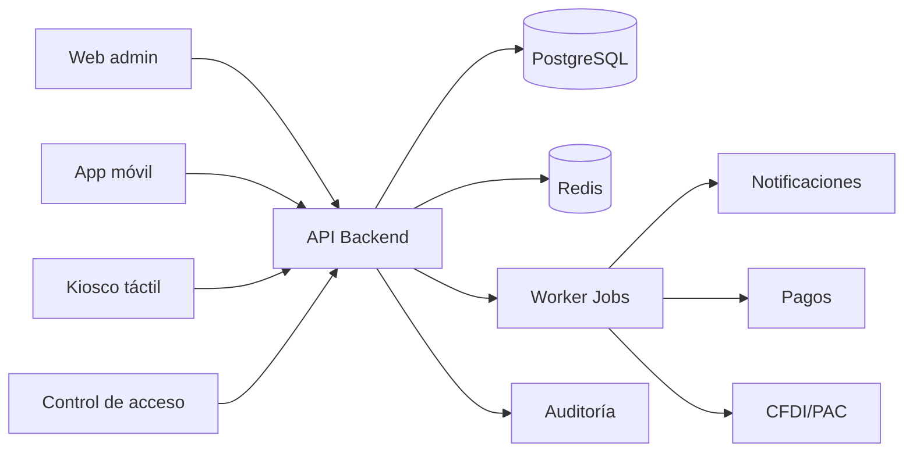

# Arquitectura general

## Visión general

La arquitectura del sistema está diseñada para un gimnasio con operación local crítica: acceso en tiempo real, pagos recurrentes, caja, facturación y reportes. El sistema se separa en 4 capas: usuario, servicios, dominio e infraestructura.

## Componentes principales

### 1. Frontend administrativo
- panel web para dueño, gerente y recepción, con campana de avisos reales por cuenta (entrenamientos pendientes de revisar y tickets asignados)
- dashboards, gestión de socios y reportes
- acceso segmentado por rol y permisos

### 2. Frontend móvil
- app Expo/React Native para socios (`mobile/`): acceso sin contraseña con código OTP por correo, consulta de perfil, membresía, acceso habilitado y saldo, reserva o cancelación de clases con lista de espera sobre la agenda del club, consulta de rutinas asignadas, entrenamientos (con detalle por serie), medidas y metas, registro de entrenamientos con series (pendientes de revisión del entrenador), de medidas y de metas propias —con cancelación de esas últimas— desde la app, consulta de pagos de membresía y estado de cuenta, y bandeja de avisos del club (revisiones, cambios de metas, lugares liberados y vencimiento de la membresía) con insignia de no leídos en el inicio
- pendiente: pago en línea, facturas, cobro de clases premium, fotos de progreso desde la app, aprobación de las metas del socio por el entrenador y notificaciones push o por correo (la bandeja ya existe, pero el aviso solo se ve al abrir la app)

### 3. Kiosco de recepción
- check-in y flujo de acceso rápido
- consulta del socio
- soporte offline con caché local

### 4. Backend API
- autenticación y autorización
- lógica de negocio y validación
- contratos y integraciones con pagos, PAC y comunicaciones

### 5. Capas de datos e infraestructura
- PostgreSQL para transacciones y almacenamiento histórico
- Redis para caché, sesiones y colas de tareas
- workers para reintentos de cobro, reportes y notificaciones

## Patrón de solución

Se adopta un enfoque modular por dominio: membresías, acceso, clases, inventario, facturación, mantenimiento, personal y comunicación. Esto permite añadir servicios extra sin rediseñar el núcleo.

Los **avisos** (`app/modules/notifications`) se escriben **dentro de la transacción del evento** que los provoca —revisión de un entrenamiento, cambio o logro de una meta, promoción de lista de espera, entrenamiento capturado desde la app, asignación de un ticket— y no desde un worker: hoy no hay Celery ni Redis desplegados y el requisito era que ningún aviso existiera sin el cambio que anuncia ni faltara después de un commit. Hay **dos bandejas y dos sujetos**: la del socio (`member_notifications`, audiencia = `member_id` de la sesión de la app) y la del personal (`staff_notifications`, audiencia = la cuenta del panel que inicia sesión). La segunda se resuelve leyendo `AppUser.employee_id`, el vínculo único empleado → cuenta que ya existía en el módulo de identidad, así que los servicios de `routines` y `maintenance` solo pasan el `employee_id` que ya tienen en su modelo; sin cuenta activa el aviso se omite y la operación de dominio se completa. El único aviso que no nace de un evento es el recordatorio de vencimiento de la membresía, que se **calcula de forma diferida al leer la bandeja** y se protege contra duplicados con un `dedupe_key` único por ventana (7/3/1 días). Cuando se desplieguen jobs, ese cálculo se puede invocar desde el worker sin cambiar el modelo.

## Estrategia de crecimiento

- mantener un dominio central con entidades compartidas
- separar procesos transversales como auditoría y notificaciones
- emplear colas para lo que no es crítico en la interación del usuario
- incorporar persistencia histórica y partición de tablas para crecimiento

## Consideraciones críticas

- acceso debe responder en <1 segundo en entorno local
- pagos y facturación requieren seguridad y trazabilidad
- las operaciones de caja y acceso deben tolerar cortes de internet
