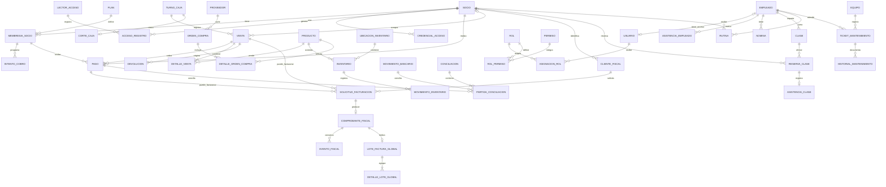

# Modelo de datos

## Principios del modelo

- Este diagrama es conceptual; nombres y cardinalidades deben convertirse en un esquema físico y migraciones antes de implementar.
- Cada entidad persistente usa identificador estable. Las fechas se almacenan en UTC y se presentan en la zona horaria del gimnasio.
- Los importes se guardan en centavos enteros o decimal exacto, nunca en `float`; cada monto conserva moneda.
- Los eventos históricos, pagos, accesos y comprobantes no se eliminan. Se conserva su estado y las relaciones de corrección o cancelación.
- Un intento de cobro no equivale a un pago confirmado; un pago confirmado tampoco equivale a un CFDI timbrado.
- El stock se explica con movimientos de inventario; cualquier saldo materializado debe poder reconciliarse contra esos movimientos.
- Los estados fiscales, cobros, ventas y accesos son dominios separados, aunque se relacionen mediante claves explícitas.

## Diagrama ER conceptual (Mermaid)

## Entidades por dominio

### Socios, membresías, pagos y acceso
- `Socio`, `Plan`, `MembresiaSocio`, `MetodoPago`, `IntentoCobro`, `Pago` y `ReintentoCobro` soportan el ciclo comercial y de cobro recurrente.
- `CredencialAcceso`, `LectorAcceso` y `AccesoRegistro` soportan credenciales, lecturas autorizadas/denegadas y sincronización offline.
- La plantilla biométrica cifrada se mantiene separada del registro de acceso; no se almacena imagen biométrica.

### Punto de venta e inventario
- `Producto`, `VarianteProducto`, `Inventario`, `UbicacionInventario` y `MovimientoInventario` modelan catálogo, existencias y trazabilidad de stock.
- `Venta`, `DetalleVenta`, `Devolucion`, `TurnoCaja` y `CorteCaja` modelan operaciones del mostrador y cierre por turno.
- `CuentaSocio` no almacena saldo: se calcula con ventas a cuenta, devoluciones abonadas y `CobroCuentaSocio`; el límite vive en `members.credit_limit_cents`.
- `EnvioEstadoCuenta` audita cada envío del estado de cuenta o recordatorio de cobranza (socio, usuario, destinatario, formato, propósito `statement`/`reminder`, fecha de corte, estado, error y `retry_of_id` cuando es un reintento). No es un movimiento de la cuenta y es append-only: reintentar agrega una fila nueva enlazada con la anterior (`20261019_0021`); el propósito y el índice por socio/propósito/fecha llegan con `20261021_0022`.
- `Proveedor`, `OrdenCompra` y `DetalleOrdenCompra` modelan el abastecimiento.

### Facturación y conciliación
- `ClienteFiscal`, `SolicitudFacturacion`, `ComprobanteFiscal` y `EventoFiscal` conservan datos fiscales, solicitud, resultado y auditoría del PAC. En el primer incremento fiscal se materializan como `member_fiscal_profiles`, `invoices` (solicitud y resultado en una fila) e `invoice_events`; separar la solicitud del comprobante queda para cuando el PAC real lo exija.
- `RelacionComprobante` vincula comprobantes corregidos, notas de crédito o cancelaciones sin borrar el original. Desde el cuarto incremento fiscal, una nota de crédito es una fila de `invoices` con `origin_type = "credit_note"` que apunta a la factura ajustada con `related_invoice_id`, registra el motivo y la nota, y conserva receptor, tasa e importes desglosados como cualquier comprobante.
- `LoteFacturaGlobal` y `DetalleLoteGlobal` se materializan desde el tercer incremento fiscal como la factura `origin_type = "global"` (periodo en `global_year`/`global_month`) y `global_invoice_sales`, que congela folio, fecha y total de cada venta incluida.
- `ComplementoPago` y `EventoComplementoPago` se materializan desde el quinto incremento fiscal como `invoice_payments` e `invoice_payment_events`: cada parcialidad de una factura PPD tiene folio, UUID y cancelación propios, conserva sus saldos y su XML, y no crea un segundo libro de cobros. La factura original no cambia de importe; su saldo se deriva de los complementos timbrados.
- `MovimientoBancario`, `Conciliacion` y `PartidaConciliacion` modelan la conciliación conceptual. El primer incremento materializa una versión **uno a uno**: `bank_accounts`, `bank_movements` y `bank_movement_events` vinculan cada línea del estado de cuenta con una sola operación interna (pago de membresía, venta, abono o devolución) y documentan la diferencia. Los depósitos agrupados, pagos divididos y partidas explícitas siguen siendo diseño futuro.

### Operación, personal y mantenimiento
- `Clase`, `ReservaClase`, `ListaEsperaClase` y `AsistenciaClase` registran agenda, cupo y participación.
- `Rutina` mantiene su relación con socio y entrenador.
- `Empleado`, `Usuario`, `Rol`, `Permiso`, `AsistenciaEmpleado`, `Nomina` y entidades relacionadas soportan personal, autorización y nómina.
- `Equipo`, `TicketMantenimiento` e `HistorialMantenimiento` registran disponibilidad, atención y costos técnicos.
- `ServicioFisioterapia`, `OfertaFisioterapia`, `PaqueteFisioterapia` y `CitaFisioterapia` modelan el consultorio: catálogo con precio suelto, paquete prepagado con créditos y vigencia, y cita con fisioterapeuta, consultorio, horario y estado; el cobro de una sesión suelta se liga a su cita por `sales.physio_appointment_id`. `ConsultorioFisioterapia`, `EspecialidadFisioterapia` y `PerfilFisioterapeuta` describen la sala y al terapeuta, y `AjustePaqueteFisioterapia` deja bitácora de las extensiones y anulaciones.

## Relaciones importantes

- un socio puede tener varias membresías históricas; una sola puede habilitar acceso según las reglas vigentes
- cada `Pago` confirmado tiene un origen de cobro identificable: una membresía o una venta; los intentos fallidos se conservan como `IntentoCobro`
- una venta puede tener varios pagos (por ejemplo, pago dividido) y varias líneas; las líneas conservan descripción, precio e impuestos aplicados en el momento de venta
- cada solicitud de facturación refiere exactamente a una venta o a un pago; puede haber varios eventos/reintentos de PAC, pero no más de un CFDI vigente incompatible para el mismo origen
- una factura de ingreso puede tener varias notas de crédito parciales; la suma de las timbradas y no canceladas nunca excede su total, y una nota siempre refiere a una factura de ingreso existente
- una factura PPD puede tener varias parcialidades; solo las **timbradas** reducen su saldo y la suma nunca excede el total. Cada complemento refiere a una sola factura y solo la última parcialidad timbrada vigente se puede cancelar
- cada movimiento de inventario registra cantidad, ubicación, motivo y referencia de origen; el saldo actual no reemplaza el historial
- la factura global guarda el detalle de operaciones incluidas y evita duplicar las ya facturadas individualmente
- en el esquema implementado, una línea del banco se vincula con **una sola** operación interna y una operación interna con **una sola** línea viva; la conciliación agrupada (varios pagos por un depósito) y las partidas explícitas quedan como diseño futuro
- cada reserva pertenece a un socio y una clase; la asistencia se registra contra la reserva
- un usuario recibe roles con vigencia y contexto; cada acción sensible conserva actor y fecha en auditoría

## Reglas de integridad por definir en el esquema físico

- Restricción exclusiva de origen para `Pago` (membresía o venta) y para `SolicitudFacturacion` (pago o venta), con excepciones de factura global representadas por su detalle de lote.
- Unicidad de SKU por alcance definido, UUID de CFDI, referencia externa idempotente y reserva activa por socio/clase.
- Los cambios de estado de pago, acceso y comprobante se registran como eventos; no se sobrescriben de forma que se pierda el historial.
- Las operaciones offline deben incluir identificador idempotente del dispositivo/origen para evitar duplicados al sincronizar.
- La retención de documentos fiscales y datos personales se configura con validación legal y fiscal, no se deriva de este modelo conceptual.

⚠️ El modelo es una base de diseño, no un dictamen fiscal ni un esquema final de producción. Debe mantenerse consistente con el glosario y los documentos de módulo.

## Esquema físico inicial: socios y cobro recurrente

La migración inicial materializa únicamente el flujo prioritario de socios, planes y cobros. Los nombres físicos usan `snake_case` en inglés, conforme a la convención de código; las entidades del dominio conservan los términos del glosario.

| Tabla | Responsabilidad | Restricciones principales |
|---|---|---|
| `members` | identidad y contacto mínimo del socio | UUID, correo normalizado único cuando existe, estado de perfil separado del estado de membresía, `credit_limit_cents` nullable (`NULL` = sin tope, `>= 0`) |
| `plans` | configuración vendible de un plan | código único, duración positiva, importe en centavos y moneda, `daily_entry_limit` nullable (`NULL` = sin límite, `>= 1`) |
| `memberships` | vigencia y estado del plan asignado | FKs restrictivas a socio/plan, periodo válido, estado controlado y máximo de una membresía no terminal por socio |
| `member_consents` | aceptación y revocación de documentos | historial con versión y fecha; no almacena datos médicos |
| `payment_methods` | referencia tokenizada del proveedor | token del proveedor cifrado, nunca PAN/CVV; un solo método predeterminado activo por socio |
| `payment_attempts` | cada intento de cobro e idempotencia | clave idempotente y huella de solicitud, número de intento positivo, estados controlados; un cobro manual con tarjeta declarada puede no tener `payment_method_id` ni proveedor |
| `payments` | cobros confirmados | un pago por intento exitoso, monto y moneda como snapshot; desde el cobro manual guarda periodo, turno de caja, cobrador y nota (los campos de periodo/turno son nulos en cobros de pasarela antiguos) |
| `payment_attempt_events` | historial de transiciones | eventos históricos vinculados al intento |
| `provider_webhook_events` | deduplicación y seguimiento de webhooks | evento único por proveedor, digest del payload y estado de procesamiento |
| `membership_events` | auditoría de cambios de membresía | estado anterior/nuevo, actor, fecha y metadatos sin secretos |

La migración está en `backend/alembic/versions/20261015_0001_memberships_billing.py`. La activación inicial de la membresía y la creación del pago confirmado deben ejecutarse en una sola transacción después de confirmar el pago; la respuesta HTTP de la pasarela por sí sola no es confirmación durable.

El cobro manual en mostrador (`20261021_0023_membership_manual_payments.py`) reutiliza `payment_attempts` y `payments` en vez de crear un libro paralelo: el intento queda `succeeded` con `provider = NULL` y el pago guarda `period_starts_at`, `period_ends_at`, `cash_session_id`, `collected_by` y `note`. El turno de caja no duplica el pago: al leer el corte suma los `payments` vinculados por `cash_session_id`, y solo el método `cash` entra al efectivo esperado.

## Esquema físico: facturación CFDI 4.0

La migración `20261023_0024_billing_cfdi.py` materializa el primer incremento fiscal, la `20261024_0025_global_invoices.py` el tercero, la `20261025_0026_credit_notes.py` el cuarto (notas de crédito), la `20261025_0028_ppd_payments.py` el quinto (complementos de pago PPD) y la `20261028_0040_invoice_cancellation_tracking.py` agrega el seguimiento de una cancelación que el SAT deja en proceso. La solicitud y el comprobante comparten fila porque el estado distingue ambos momentos; el historial de intentos vive en `invoice_events`. Los complementos viven en dos tablas propias porque una factura PPD tiene varias parcialidades, cada una con su folio, UUID, XML y cancelación.

| Tabla | Responsabilidad | Restricciones principales |
|---|---|---|
| `member_fiscal_profiles` | datos fiscales del socio para prellenar la siguiente solicitud | un perfil por socio (`uq_member_fiscal_profiles_member`), RFC de 12–13 caracteres, FK restrictiva al socio |
| `invoices` | solicitud y resultado del CFDI, con snapshot del receptor, importes, timbrado y cancelación; también la factura global con su periodo, la nota de crédito con su relación y la factura PPD que se liquida con complementos | `origin_type` (`sale`/`membership_payment`/`global`/`credit_note`) y `status` (`requested`/`failed`/`stamped`/`cancelled`) con CHECK; `payment_method` (`PUE` por defecto o `PPD`; PPD usa `payment_form = '99'`); total positivo y `subtotal + impuesto = total`; `(series, folio)`, `idempotency_key` y `uuid` únicos; `request_fingerprint` de la solicitud; actor de alta, timbrado y cancelación; XML y referencias del PAC opcionales; `cancellation_requested_at`/`cancellation_checked_at` nulos salvo cuando el SAT dejó la cancelación en proceso; `global_year`/`global_month` nulos salvo en `global` (`ck_invoices_global_period`); `related_invoice_id`, `credit_note_reason` y `credit_note_note` solo en `credit_note` (`ck_invoices_credit_note`), con FK autorreferente `RESTRICT` e índice `ix_invoices_related` |
| `invoice_items` | conceptos del comprobante con su parte gravable | posición y cantidad positivas, `subtotal + impuesto = total`, unicidad `(invoice_id, position)`, FK en cascada; el unitario de la global se deriva del subtotal entre la cantidad de operaciones |
| `invoice_events` | bitácora append-only de solicitudes, intentos y cancelaciones | tipo de evento, estado anterior/nuevo, actor, detalle JSON sin secretos y fecha; índice por factura y fecha |
| `global_invoice_sales` | trazabilidad de cada venta incluida en una factura global | unicidad `(invoice_id, sale_id)`, total positivo, FK en cascada a la factura y restrictiva a la venta; folio, fecha y total congelados; índices por factura y por venta |
| `invoice_payments` | una parcialidad (complemento de pago) de una factura PPD, con su folio, XML, saldos y cancelación | FK restrictiva a la factura; serie `P` por defecto; estados `requested`/`failed`/`stamped`/`cancelled`; `(series, folio)`, `idempotency_key` y `uuid` únicos; importe, parcialidad y folio positivos; `prior_balance > 0`, `amount <= prior_balance` y `outstanding = prior_balance − amount`; forma de pago real de dos caracteres; fecha de pago; tasa de IVA congelada; `request_fingerprint`; actores de alta, timbrado y cancelación; índices por factura/tiempo, factura/parcialidad y estado/tiempo |
| `invoice_payment_events` | bitácora append-only del complemento | evento (`payment_requested`/`payment_stamped`/`payment_stamp_failed`/`payment_cancelled`), estado anterior/nuevo, actor, detalle JSON sin secretos y fecha; FK en cascada al complemento e índice por complemento/fecha |

El índice único parcial `uq_invoices_active_origin` (`origin_type`, `origin_id` donde `status <> 'cancelled'` y `origin_type <> 'credit_note'`) impide dos facturas vivas para la misma venta o pago; cancelar conserva la fila y libera el origen para emitir la sustitución. Las notas de crédito quedan fuera del índice porque una factura admite varias parciales: su saldo —total de la factura menos notas timbradas y no canceladas— se controla en el servicio con `SELECT ... FOR UPDATE` sobre la factura original, tanto al crear como al timbrar. La nota apunta a la factura ajustada con `related_invoice_id` (FK autorreferente restrictiva), de modo que el comprobante relacionado no puede borrarse, y no crea tabla propia: sus conceptos viven en `invoice_items` y sus eventos en `invoice_events`. Para la global, `uq_invoices_active_global_period` (`global_year`, `global_month` donde la factura no está cancelada) impide dos globales vivas del mismo mes; la global usa un `origin_id` UUIDv5 determinista (`GLOBAL-YYYY-MM`) y la tabla `global_invoice_sales` impide además incluir la misma venta en dos globales vivas. El folio, la fecha y el total de la venta se copian al lote: cancelar o editar la factura global no reescribe la historia de la venta original. `invoices.uuid` es nulo en las facturas simuladas (no hay timbre del SAT) y se llena solo con un PAC real. El XML timbrado se guarda completo en `invoices.xml_content`; no hay tabla de archivos. La representación impresa (PDF) **no se almacena**: se genera al momento desde la factura, sus conceptos y el emisor, y solo se entrega para facturas timbradas o canceladas. Los envíos por correo no crean una tabla propia: se registran como eventos `invoice_email_sent`/`invoice_email_failed` en `invoice_events`, con destinatario, adjuntos (`pdf`, `xml`), estado de entrega y error. El emisor no se duplica en base de datos: se configura por entorno (`GYM_RFC`, `GYM_LEGAL_NAME`, `GYM_TAX_REGIME`, `GYM_POSTAL_CODE`, `CFDI_CERTIFICATE_NUMBER`, `CFDI_SERIES`, `CFDI_TAX_RATE_PERCENT`, `CFDI_PRODUCT_CODE`, `CFDI_SERVICE_CODE`).

El complemento de pago **no** modifica `invoices.total_cents`, no crea una fila en `payments` ni mueve caja: documenta fiscalmente una parcialidad que el operador declara. El saldo de una factura PPD es `total_cents − suma de complementos timbrados` (los cancelados no cuentan), y una solicitud `requested` o `failed` no lo consume; el timbrado bloquea la factura y el complemento, revalida el importe y recalcula `partiality_number`, `prior_balance_cents` y `outstanding_balance_cents`, de modo que las parcialidades timbradas quedan numeradas 1, 2, 3… sin huecos aunque se hayan registrado solicitudes fuera de orden. Solo se cancela la **última parcialidad timbrada vigente** y una factura con complementos timbrados no se cancela hasta cancelarlos; una factura PPD no acepta notas de crédito en esta versión. La FK restrictiva a `invoices` impide borrar una factura con complementos. El XML se guarda en `invoice_payments.xml_content` y la representación impresa se genera al momento desde el complemento y la factura; no hay tabla de archivos. Un complemento simulado deja `uuid` nulo y `is_simulated = true`. Los bloqueos `SELECT ... FOR UPDATE` son efectivos en PostgreSQL y no-op en SQLite, así que la garantía de saldo y numeración en concurrencia depende del motor de producción.

## Esquema físico: conciliación bancaria

La migración `20261025_0027_bank_reconciliation.py` agrega las cuentas, las líneas del estado de cuenta y su bitácora, además del permiso `finance.manage` para dueño y contador. La cuenta es un catálogo, no un libro: el «saldo» que muestra el panel es la suma de las líneas importadas.

| Tabla | Responsabilidad | Restricciones principales |
|---|---|---|
| `bank_accounts` | cuenta bancaria cuyas líneas se concilian | UUID, `lower(name)` único (`uq_bank_accounts_name_lower`), últimos cuatro dígitos (`account_last4`, longitud 4), moneda de tres letras, estado `active`/`inactive` con CHECK y `created_by` con FK `RESTRICT`; no guarda número completo, CLABE ni credenciales |
| `bank_movements` | una línea del estado de cuenta con signo | fecha, importe `BIGINT` distinto de cero, moneda, referencia y descripción; estado `pending`/`reconciled`/`difference`/`reviewing`; vínculo polimórfico `matched_source`/`matched_id` con CHECK de par completo, `reconciled` exige `matched_id`, `difference_cents` solo existe con vínculo y estado `difference`; unicidad `(bank_account_id, import_hash)`; índices por cuenta/fecha, estado y fecha; índices de actores con FK `RESTRICT` |
| `bank_movement_events` | bitácora append-only de la línea | `imported`/`matched`/`unmatched`/`flagged`/`reopened` con CHECK, detalle de hasta 400 caracteres, actor FK `RESTRICT`, fecha e índice por movimiento/fecha; no se actualiza ni se borra |

El índice único parcial `uq_bank_movements_match` sobre `(matched_source, matched_id)` donde `matched_id IS NOT NULL` impide que dos líneas del banco reclamen la misma operación interna. `matched_id` **no** es una FK real porque apunta a cuatro tablas distintas (`payments`, `sales`, `member_account_payments`, `sale_returns`); la existencia, el método electrónico, la moneda y el sentido del movimiento se validan en el servicio antes de vincular. Desvincular limpia el vínculo y devuelve la línea a `pending`, conservando el evento. El `import_hash` es SHA-256 de cuenta, fecha, importe, referencia y descripción (sin distinguir mayúsculas), de modo que reimportar el mismo estado no duplica; dos líneas legítimamente idénticas se consideran duplicadas. El `downgrade` de la migración se niega a ejecutarse si existen movimientos bancarios. Los bloqueos `SELECT ... FOR UPDATE` de las conciliaciones son efectivos en PostgreSQL y no-op en SQLite, así que la garantía de concurrencia en producción depende del motor. No hay eventos de auditoría para cambios de cuenta y no se permite borrar una cuenta con historial.

## Esquema físico: portal del socio

La migración `20261027_0031_member_portal.py` agrega la autenticación de la app móvil. El socio no tiene contraseña: recibe un código temporal por correo y obtiene una sesión propia, separada de `user_sessions` del personal.

| Tabla | Responsabilidad | Restricciones principales |
|---|---|---|
| `member_login_codes` | código OTP de un solo uso enviado al correo del socio | FK `RESTRICT` al socio, `code_hash` SHA-256/HMAC de 64 caracteres, `created_at`/`expires_at` (10 minutos), `consumed_at` nullable, `attempts` entero no negativo (máximo 5 en el servicio), `ck_member_login_codes_attempts` y `ck_member_login_codes_expiry_order`; índice por socio y fecha de creación |
| `member_sessions` | sesión opaca de la app del socio | `token_sha256` único, `expires_at` (30 días), `revoked_at` y `last_seen_at`; `ck_member_sessions_expiry_order`; índice por socio y vencimiento |
| `member_auth_events` | bitácora de autenticación del socio | FK nullable al socio, `event_type` (`code_requested`/`code_delivery`/`code_verified`/`login`/`logout`), `result` (`success`/`failure`), `reason_code` y `occurred_at`; índice por socio y fecha; nunca guarda código ni token |

El código se almacena solo como HMAC-SHA256 calculado con `SECRET_KEY` sobre el id del código, el id del socio y el código; la sesión solo conserva el SHA-256 del token. La base de vista previa crea estas tablas con `create_all`; en producción se aplican con Alembic. No hay relación con `app_users`, `user_sessions` ni la matriz RBAC: el portal solo expone las rutas `/member/*` y el socio autenticado únicamente puede leer su propio perfil.

Las **reservas de clases desde la app** no agregan tablas ni columnas: reutilizan `class_sessions` y `class_reservations` con `origin = "app"`, y la capa `app.modules.portal.classes` solo filtra por el socio de la sesión antes de delegar en el servicio de clases. `cancelled_by` sigue siendo una FK a `app_users`, así que una cancelación hecha por el socio lo deja en `NULL`; el origen distingue la reserva, no al actor de la cancelación.

Las **rutinas y el progreso del socio** leen `routine_assignments` (con la `routine_version` fijada), `routine_items` de esa versión, `workout_logs`, `workout_sets`, `body_measurements` y `member_goals` a través de `app.modules.portal.routines`, que acota todo por el socio de la sesión. El registro de entrenamientos y medidas desde la app agrega la migración `20261027_0032_member_activity_origin.py`, que da a `workout_logs` y `body_measurements` la columna `origin` (`'staff'` | `'app'`, CHECK `ck_workout_logs_origin` / `ck_body_measurements_origin`, `server_default 'staff'`). Los entrenamientos de la app nacen `logged` y el entrenador los pasa a `reviewed`; las medidas son append-only y se aplican de inmediato a las metas. `logged_by`/`measured_by` siguen siendo FK a `app_users` y quedan en `NULL` en los registros de origen `app`, porque el socio no es un usuario del personal: `origin` distingue el canal, no al actor.

El **alta y cancelación de metas desde la app** agrega la migración `20261027_0034_member_goal_origin.py`, que da a `member_goals` la columna `origin` (`'staff'` | `'app'`, CHECK `ck_member_goals_origin`, `server_default 'staff'`); las metas anteriores quedan como `staff`. El socio solo crea metas con origen `app` y solo puede cancelar las que él mismo creó: una meta del personal responde `409` en la app y se administra en el panel con `routines.manage`. El baseline se sigue tomando de la última medición al crear la meta y se conserva congelado, y `created_by` queda en `NULL` en las metas de la app por la misma razón que `logged_by`/`measured_by`. El cierre de asignaciones sigue escribiéndose solo desde el panel.

Las **fotos de progreso desde la app** agregan la migración `20261028_0041_progress_photo_origin.py`, que da a `progress_photos` la columna `origin` (`'staff'` | `'app'`, CHECK `ck_progress_photos_origin`, `server_default 'staff'`); las fotos anteriores quedan como `staff`. La app reutiliza `progress_photos` y el almacenamiento fuera de la base: no hay tabla ni columna nuevas aparte de `origin`, y `uploaded_by` sigue siendo una FK a `app_users` que queda en `NULL` en las cargas del socio. El consentimiento se guarda en `member_consents` con `consent_type = 'progress_photos'` y `document_version = 'fotos-progreso-v1'`; es una precondición de la primera carga, se escribe una sola vez y se revierte si la imagen se rechaza. La app solo ve y elimina fotos de su `member_id` (una ajena responde `404`), y la descarga usa un enlace firmado con HMAC-SHA256 de `photo:<id>:<exp>` y `SECRET_KEY` —vigencia de 10 minutos—, sin Bearer en la URL, igual que las facturas del socio (ADR-019, ADR-023).

El **detalle por serie** vive en `workout_sets` (migración `20261027_0033_workout_sets.py`): una fila por serie ejecutada, con FK en cascada al entrenamiento y FK restrictiva al ejercicio, índice único `(workout_id, exercise_id, set_number)` e índice por entrenamiento. El servicio valida que el ejercicio pertenezca al plan de la `routine_version` de la asignación; la lectura ordena por `routine_items.position` y `set_number`. Las series se escriben en la misma transacción que el entrenamiento y no se editan después.

| Tabla | Responsabilidad | Restricciones principales |
|---|---|---|
| `workout_sets` | una serie ejecutada dentro de un entrenamiento (ejercicio, número, repeticiones y peso) | FK `CASCADE` a `workout_logs` y `RESTRICT` a `exercises`; único `(workout_id, exercise_id, set_number)`; `ck_workout_sets_number_positive`, `ck_workout_sets_reps_range` (1–100) y `ck_workout_sets_weight_range` (0–1000 o `NULL`); máximo 60 series por entrenamiento en el servicio; `created_at` igual al `performed_at` |

Los **pagos y el estado de cuenta del socio** reutilizan `payments` (con su `membership_id` y el plan de la membresía) y el estado de cuenta calculado por `member_account_statement` sobre las ventas a cuenta, las devoluciones abonadas y `member_account_payments`. `app.modules.portal.payments` solo filtra por el socio de la sesión, pagina los pagos y recorta a 100 los movimientos más recientes; no crea tablas, columnas ni movimientos, y deja fuera los datos internos del personal (turno, cobrador y límite de crédito).

Los **avisos** viven en dos tablas espejo del módulo transversal `app.modules.notifications`: `member_notifications` (migración `20261027_0035_member_notifications.py`) para los socios y `staff_notifications` (migración `20261027_0036_staff_notifications.py`) para las **cuentas del panel**. Es un **mensaje congelado**, no una referencia a datos vivos: el título y el cuerpo se redactan al producirse el evento, así que editar o borrar el origen nunca deja un aviso incomprensible; `ref_id` guarda el identificador de origen **sin FK** porque puede apuntar a distintas tablas según el `kind`. La audiencia del personal se resuelve leyendo `AppUser.employee_id`, el vínculo único empleado → cuenta que ya existía desde el módulo de identidad. La audiencia del aviso de equipo caído la resuelve **mantenimiento**, uniendo `routine_assignments` → `routine_items` por la versión congelada de la asignación → `exercises.equipment_id`, y pasa la lista de socios al emisor: `notifications` no consulta tablas de rutinas. El aviso de estado de factura lo emite **facturación** desde `Invoice.member_id`, dentro de la misma transacción que cambia el estado: el aviso no puede sobrevivir a un timbrado revertido.

El **envío** de esos avisos vive en tres tablas satélite: `staff_notification_deliveries` (el correo del personal, con su `Message-ID` y su estado de transporte), `staff_notification_delivery_receipts` (los acuses que el proveedor devuelve después, solo agregados) y `member_push_deliveries` junto a `member_push_tokens` (el push del socio por dispositivo). Ninguna reescribe el aviso: el aviso es historial y el envío es su trazabilidad.

| Tabla | Responsabilidad | Restricciones principales |
|---|---|---|
| `member_notifications` | un aviso para un socio, con su texto congelado y su fecha de lectura | FK `RESTRICT` al socio; `kind` con CHECK `ck_member_notifications_kind` (`workout_reviewed`/`goal_achieved`/`goal_updated_by_staff`/`goal_cancelled_by_staff`/`class_waitlist_promoted`/`membership_expiring`/`equipment_out_of_service`/`invoice_stamped`/`invoice_failed`/`invoice_cancelled`, ensanchado por las migraciones `20261027_0037_equipment_out_of_service_notice.py` y `20261028_0039_invoice_status_notifications.py`); `title` 1–140 y `body` 1–500 con CHECK; `ref_id` UUID sin FK; `dedupe_key` hasta 120 con **índice único parcial** donde no es nulo; `created_at` con `server_default now()`; `read_at` nullable; índices `(member_id, created_at)` y `(member_id, read_at)` |
| `staff_notifications` | un aviso para una cuenta del panel (entrenador o técnico), con su texto congelado, su fecha de lectura y su fecha de cierre | FK `RESTRICT` a `app_users`; `kind` con CHECK `ck_staff_notifications_kind` (`workout_pending_review`/`maintenance_ticket_assigned`/`kiosk_token_expiring`, y desde `20261031_0061_attendance_requests_notices_audit.py` `attendance_corrected`/`attendance_voided`/`attendance_request_pending`/`attendance_request_approved`/`attendance_request_rejected`, más `attendance_request_overdue` desde `20261031_0062_attendance_request_sla_and_escalation.py`); `title` 1–140 y `body` 1–500 con CHECK; `ref_id` UUID sin FK; `dedupe_key` hasta 120 con **índice único parcial** donde no es nulo; `created_at` con `server_default now()`; `read_at` nullable; `resolved_at` nullable (migración `20261029_0054_staff_notification_resolved.py`); índices `(user_id, created_at)` y `(user_id, read_at)` |
| `staff_notification_deliveries` | el correo encolado para un aviso del personal: destinatario congelado, estado e intentos | FK `RESTRICT` a `staff_notifications` con `uq_staff_notification_deliveries_notice` —una entrega por aviso, así que un aviso deduplicado no encola dos veces—; `recipient` VARCHAR(254), la dirección de la cuenta activa en el momento del aviso; `message_id` VARCHAR(320) con índice único, el `Message-ID` congelado que el mensaje deja al salir; `status` (`pending`/`sent`/`simulated`/`failed`) con `ck_staff_notification_deliveries_status` y `attempts` no negativo con `ck_staff_notification_deliveries_attempts`; `error` hasta 500, `last_attempt_at` y `sent_at` nullable; `created_at` con `server_default now()` e índice `(status, created_at)`; la escribe `create_staff_notification` en la misma transacción del aviso, la migración `20261031_0065` la crea, la pasada posterior a la respuesta la envía para los nueve tipos del personal y `20261031_0066` le añade `message_id` (ADR-048, ADR-049, ADR-050, ADR-051) |
| `staff_notification_delivery_receipts` | el acuse que el proveedor devuelve sobre un correo ya enviado; solo se agrega | FK `RESTRICT` a `staff_notification_deliveries`; `provider_event_id` VARCHAR(120) **único** (idempotencia del webhook); `event_type` (`delivered`/`bounced`/`complained`) con `ck_staff_notification_delivery_receipts_event`; `occurred_at` y `detail` hasta 500 nullable; `received_at` con `server_default now()` e índice `(delivery_id, received_at)`; la crea la migración `20261031_0066` y nunca reescribe el estado del transporte (ADR-051) |
| `member_push_tokens` | un dispositivo del socio donde la app puede recibir notificaciones | FK `RESTRICT` a `members`; `token` VARCHAR(255) **único** (`ExponentPushToken[...]`/`ExpoPushToken[...]`); `platform` (`ios`/`android`) con `ck_member_push_tokens_platform`; `active` booleano con `server_default true`; `created_at`, `last_seen_at` y `deactivated_at`; índice `(member_id, active)`. Registrar un token que ya existía lo transfiere a la cuenta que acaba de entrar y lo reactiva; desactivar es una bandera, nunca un borrado (ADR-052) |
| `member_push_deliveries` | un push encolado para un aviso y un dispositivo | FK `RESTRICT` a `member_notifications` y a `members`; `token` VARCHAR(255) como instantánea del dispositivo; `status` (`pending`/`sent`/`simulated`/`failed`) con `ck_member_push_deliveries_status` y `attempts` no negativo; `uq_member_push_deliveries_notification_token` impide encolar dos veces el mismo aviso al mismo teléfono; `next_attempt_at` nullable guarda el reintento automático programado (`NULL` si no hay nada pendiente), `error` hasta 500, `last_attempt_at` y `sent_at` nullable; `created_at`, índice `(status, created_at)` para la cola e índice `(status, next_attempt_at)` para los reintentos vencidos; la escribe `create_notification` en la misma transacción del aviso (salvo los recordatorios perezosos) y la pasada posterior a la respuesta la envía; migración `20261031_0067` (ADR-052) y `20261031_0068` añade `next_attempt_at` (ADR-054) |

| Relación | Regla |
|---|---|
| un socio o una cuenta recibe muchos avisos y un aviso pertenece a un solo destinatario | borrar un socio o una cuenta con avisos está bloqueado por la FK `RESTRICT`: el borrado de socios sigue siendo lógico |
| un aviso describe un evento de otro módulo | no hay FK al origen: `ref_id` es una pista, y la integridad del texto no depende de que el origen siga existiendo |
| dos avisos iguales no pueden coexistir | lo impide el índice único parcial sobre `dedupe_key`; `_append` hace `flush()` de los cambios pendientes del llamante antes de abrir el savepoint y devuelve la fila existente si pierde la carrera, así que una colisión nunca revierte el ticket o el entrenamiento que se estaba insertando |
| un aviso no se edita ni se borra | `read_at` y `resolved_at` son las únicas columnas que cambian después del alta; ambas bandejas son historial |
| un aviso del personal deja de deber trabajo | `resolved_at` lo escribe el servicio que completa la tarea anunciada —`review_workout` al revisar— dentro de su transacción; el lector nunca lo toca y los conteos de no leídos lo excluyen (ADR-038) |
| un acuse pertenece a un mensaje que salió | la FK lo ata a una entrega y el servicio solo acepta entregas `sent`; los acuses se agregan y no modifican ni el estado ni la fecha de envío (ADR-051) |
| un push pertenece a un aviso y a un dispositivo | el par `(notification_id, token)` es único; el token se copia al encolar, así que retirar el dispositivo después no borra la evidencia de dónde se intentó (ADR-052) |
| un push fallido se reintenta solo hasta tres veces | `next_attempt_at` programa las esperas de un y cinco minutos y el `attempts` compartido con el reclamo compare-and-set frena la pasada; un `DeviceNotRegistered` no se reprograma (ADR-054) |
| un empleado puede no tener cuenta del panel | si `staff_user_for_employee` no encuentra una cuenta **activa**, el aviso se omite en silencio y la operación de dominio se completa igual |

Los **recordatorios** no necesitan programador: `_ensure_membership_expiring` lo calcula al leer la bandeja sobre la membresía `active` que termina primero y lo escribe con `dedupe_key = membership_expiring:<membership_id>:<7|3|1>`, de modo que hay **un aviso por ventana** y no uno por día; `_ensure_class_reminders` hace lo mismo con cada reserva `reserved` de una clase `scheduled` que empieza en 24 o 2 horas, con `dedupe_key = class_reminder:<reservation_id>:<24|2>` (ADR-035), y `_ensure_physio_reminders` escribe un `physio_reminder` por cada cita `scheduled` de fisioterapia en las próximas 24 horas, con `dedupe_key = physio_reminder:<appointment_id>:24`. Los demás avisos los escriben los servicios de `routines` y `classes` dentro de la misma transacción del cambio que anuncian: la confirmación `class_reserved` se inserta en `reserve_seat` junto con la reserva y solo cuando queda `reserved` (ADR-036); la cancelación de una clase escribe un `class_cancelled` por cada reserva viva —sentada o en espera, resuelta por `_live_reservations`— y un cambio de inicio o fin escribe `class_rescheduled` con las dos ventanas (ADR-037). El único aviso que se cierra solo es el pendiente de revisión: `review_workout` sella `resolved_at` en su misma transacción y desde ahí el aviso deja de contar para el panel pero sigue en la lista (ADR-038).

## Esquema físico: fisioterapia

El incremento 1 del módulo 10 (ADR-039) agrega cuatro tablas con la migración `20261029_0055_physiotherapy.py` y la columna `sales.physio_appointment_id` (FK `RESTRICT` con índice), que liga el cobro de una sesión suelta a su cita. El paquete **no guarda estado**: el saldo es `sessions_total - sessions_used` y el estado (`active`/`exhausted`/`expired`/`voided`) se deriva contra `valid_until` y `voided_at`. El incremento 3 (`20261030_0058_physio_control.py`) agrega los catálogos de consultorios y especialidades, el perfil del fisioterapeuta, la bitácora de ajustes del paquete y `room_id` en la cita.

| Tabla | Responsabilidad | Restricciones principales |
|---|---|---|
| `physio_services` | servicio del catálogo con duración y precio suelto | `code` normalizado a mayúsculas con índice único `lower(code)`; `price_cents >= 0`; `duration_minutes > 0` |
| `physio_offers` | paquete vendible: sesiones, precio final, precio de lista, vigencia y modo de pago | FK `RESTRICT` al servicio; nombre único `lower(name)`; `payment_mode = 'single'`; `price_cents <= list_price_cents`; `sessions > 0` |
| `physio_packs` | saldo prepagado de un socio: créditos totales, usados, vigencia, venta que lo originó y anulación | FK `RESTRICT` a socio y oferta; `sale_id` único; `0 <= sessions_used <= sessions_total`; índice `(member_id, valid_until)`; anulación con `voided_at`, `voided_by`, `void_reason` y `voided_sessions` (`ck_physio_packs_voided_range`) |
| `physio_appointments` | cita con socio, servicio, paquete ligado (opcional), fisioterapeuta, consultorio, horario y estado | FKs `RESTRICT`; `status` en `scheduled`/`attended`/`no_show`/`cancelled` (`ck_physio_appointments_status`); `ends_at > starts_at`; índice único parcial `uq_physio_appointments_therapist_start` sobre `(therapist_employee_id, starts_at)` donde el estado no es `cancelled`; índices por `starts_at`, `(member_id, starts_at)`, `pack_id` y `room_id` |
| `physio_rooms` | consultorio del catálogo | nombre único por `lower(name)` (`uq_physio_rooms_name_lower`); `is_active` |
| `physio_specialties` | especialidad del fisioterapeuta | nombre único por `lower(name)` (`uq_physio_specialties_name_lower`); `is_active` |
| `physio_therapist_profiles` | especialidad y consultorio predeterminado de un colaborador | `employee_id` único (`uq_physio_therapist_profiles_employee`); FKs opcionales a especialidad y consultorio con índice |
| `physio_pack_adjustments` | bitácora de extensiones y anulaciones del paquete | FK al paquete; `kind` en `extension`/`void` (`ck_physio_pack_adjustments_kind`); `days` nulo o positivo; motivo obligatorio y acotado; índice `(pack_id, created_at)` |

| Relación | Regla |
|---|---|
| una cita puede estar cubierta por un paquete o cobrarse suelta | `pack_id` es anulable y se reasigna si al asistir el ligado ya no tenía crédito; el cobro suelto se reconoce por `sales.physio_appointment_id` y el SKU `FISIO` |
| una venta de paquete origina créditos | `physio_packs.sale_id` es único y no hay columna inversa en `sales`: el paquete se ajusta (extiende o anula) pero no se reembolsa |
| todo ajuste del paquete deja rastro | `physio_pack_adjustments` guarda tipo, días, motivo y actor; el paquete no se edita en sitio y una anulación nunca borra la venta |
| la cita apunta al consultorio del catálogo | `room_id` es opcional y se resuelve al predeterminado del fisioterapeuta; `room` conserva el nombre como foto y el consultorio no se reserva como recurso |
| un crédito se consume una sola vez | `sessions_used` se incrementa bajo `SELECT ... FOR UPDATE` de la cita y del paquete, con la garantía de PostgreSQL (no-op en SQLite) y prueba opt-in |
| dos citas del mismo fisioterapeuta no comparten inicio | lo impide el índice único parcial; el traslape parcial se valida en el servicio, no en la base |
| los precios de la oferta son una foto | `list_price_cents` y `price_cents` se congelan al crear la oferta y no se recalculan si cambia el precio suelto |

## Esquema físico: turnos y asistencia del personal

El módulo de personal lleva operando desde su incremento en `employees`/`app_users`, y sus tablas de turnos y asistencia existían **solo en los modelos**: la base de vista previa las crea `create_all` y el panel las consulta sin problema, pero **ninguna migración las definía**, así que una base PostgreSQL construida con `alembic upgrade head` no las tenía y cualquier consulta de turnos habría caído con `relation does not exist`. La migración `20261027_0038_staffing_shifts_and_attendance.py` las agrega con la forma exacta que los modelos publican; la detectó `alembic check` en su primera corrida (ver `backend/README.md`).

| Tabla | Responsabilidad | Restricciones principales |
|---|---|---|
| `staff_shifts` | un turno programado a un empleado, con su ventana horaria | FK `RESTRICT` a `employees` y a `app_users` (quien lo programó); `ck_staff_shifts_period_valid` (`ends_at > starts_at`) y `ck_staff_shifts_status` (`scheduled`/`cancelled`, con `server_default 'scheduled'`); `created_at`/`updated_at` con `server_default now()`; índices `(employee_id, starts_at)` y `(starts_at, status)` |
| `staff_attendance` | el marcaje real de un turno: entrada, salida y estado | FK `RESTRICT` a `staff_shifts` con el índice único **parcial** `uq_staff_attendance_shift ... WHERE voided_at IS NULL` (un marcaje vivo por turno; los anulados no ocupan el turno), a `employees` y a `app_users` para los actores de entrada y salida; `ck_staff_attendance_status` (`present`/`late`) y `ck_staff_attendance_checkout_order` (`check_out_at IS NULL OR check_out_at >= check_in_at`); salida y su actor/fuente son nullable; `voided_at`/`voided_by` (`RESTRICT` a `app_users`)/`void_reason` marcan la anulación desde `20261030_0060_attendance_void_and_policy.py`; índice `(employee_id, check_in_at)` |
| `staff_attendance_events` | bitácora append-only de cada marcaje | FK `RESTRICT` a `staff_attendance` y a `app_users`; `uq_staff_attendance_events_request` sobre `request_id` es la **idempotencia** del alta, con `request_sha256` (64) para detectar la misma clave con otros datos; `ck_staff_attendance_events_type` (`check_in`/`check_out`/`check_in_correction`/`check_out_correction`/`check_out_voided`/`attendance_voided`, desde `20261030_0060_attendance_void_and_policy.py`; `20261030_0059` había ampliado `event_type` a 32 caracteres y agregado los dos de corrección) y `ck_staff_attendance_events_source` (`staff_app`/`manual`/`access_reader`); `reason` nullable; `attendance_request_id` nullable con FK `SET NULL` a `staff_attendance_requests` —la solicitud que aplicó el cambio, nula cuando se hizo desde el panel— desde `20261031_0063_attendance_request_event_link.py`, rellenada para las aprobaciones anteriores por `20261031_0064_attendance_request_link_backfill.py`; índices `(attendance_id, occurred_at)`, `request_id` y `(attendance_request_id)` |
| `staffing_settings` | política de asistencia del club, en una sola fila | PK `id` (= 1); `check_in_early_grace_minutes` (15 por defecto) y `lateness_tolerance_minutes` (0 por defecto) con `CHECK` de 0 a 240; `attendance_request_sla_hours` (24 por defecto) con `ck_staffing_settings_request_sla` de 0 a 720 desde `20261031_0062`; `attendance_email_enabled` (verdadero por defecto) desde `20261031_0065`, que decide si los avisos del personal se encolan por correo —su nombre conserva el del primer corte, pero el canal cubre los nueve tipos desde ADR-050—; `updated_at` con `server_default now()`; la crea la primera lectura del panel, no una migración de datos |
| `staffing_settings_events` | una foto antes/después de cada cambio real de la política, con su actor | FK `RESTRICT` a `app_users` (`actor_id` nullable solo para cambios sin sesión, como pruebas o semillas); `previous_check_in_early_grace_minutes`/`previous_lateness_tolerance_minutes` y los dos valores nuevos, más `previous_attendance_request_sla_hours`/`attendance_request_sla_hours` desde `20261031_0062` y `previous_attendance_email_enabled`/`attendance_email_enabled` desde `20261031_0065`; `changed_at` con `server_default now()` e índice `ix_staffing_settings_events_changed`; guardar los mismos valores no escribe fila (migración `20261031_0061_attendance_requests_notices_audit.py`) |
| `staff_attendance_requests` | lo que el colaborador pide cambiar de una de sus marcas, con su justificación y la decisión de un supervisor | FK `RESTRICT` a `staff_attendance`, a `employees` y a `app_users` (`requested_by` y `decided_by`); `ck_staff_attendance_requests_mark` (`check_in`/`check_out`), `..._action` (`correct`/`void`), `..._status` (`pending`/`approved`/`rejected`), `..._proposed` (corregir exige `proposed_at`, anular lo prohíbe) y `..._decision` (fuera de `pending`, `decided_by` y `decided_at` no son nulos); `due_at` nullable desde `20261031_0062` (el plazo congelado; nulo cuando la solicitud ya estaba decidida o el club no tiene plazo); `justification` 500 y `decision_note` 300; el índice único **parcial** `uq_staff_attendance_requests_pending` sobre `(attendance_id, mark, action) WHERE status = 'pending'` impide dos solicitudes abiertas para la misma marca; índices `(status, created_at)`, `(employee_id, created_at)` y `(status, due_at)`; mismas migraciones `20261031_0061` y `20261031_0062`. Los eventos aplicados al aprobarla apuntan de vuelta con `attendance_request_id` (ADR-046) |

Se escriben dos `source`: `staff_app`, el que pasan `POST /staff/attendance/clock-in` y `clock-out` desde la pestaña «Mi jornada» (auto-servicio con `attendance.self`), y `manual`, el que pasan `POST /admin/staff/attendance` al registrar una marca faltante, `POST /admin/staff/attendance/{attendance_id}/corrections` al corregir una existente y `POST /admin/staff/attendance/{attendance_id}/voids` al anularla, todos con `attendance.manage` y motivo obligatorio (`reason`); comparten la regla de una sola marca viva por turno y la bitácora idempotente por `request_id`. La corrección no borra el evento original: la fila de `staff_attendance` pasa a `check_in_source`/`check_out_source = "correction"` y la bitácora suma un evento `check_in_correction`/`check_out_correction` con su motivo y su actor, y recalcula el estado contra `starts_at` (ADR-042). La anulación tampoco borra: anular la salida limpia `check_out_at`, su fuente y su actor y conserva la entrada; anular la entrada marca la fila con `voided_at`/`voided_by`/`void_reason` y el turno vuelve a quedar libre gracias al índice parcial; en ambos casos la bitácora suma `check_out_voided`/`attendance_voided` (ADR-043). `access_reader` sigue declarado en el `CHECK` sin llamador: será el lector físico del control de acceso, que todavía no está conectado. El alta de turnos desde el panel es `POST /admin/staff/{employee_id}/shifts` con `attendance.manage`. La gracia de entrada y la tolerancia de retardo viven en `staffing_settings` y las lee `read_attendance_policy` sin escribir; sin fila valen 15 y 0 minutos (ADR-043). `staffing_settings_events` guarda la foto anterior y nueva de cada cambio real con su actor, y `staff_attendance_requests` registra lo que el colaborador pide —corrección con hora propuesta o anulación— con su justificación y la decisión del supervisor; aprobar la solicitud reutiliza el mismo camino de corrección o anulación (`commit=False`), así que la bitácora del turno y la marca quedan idénticas a una edición hecha desde el panel, y el índice único parcial `uq_staff_attendance_requests_pending` deja una sola solicitud abierta por marca y acción. El ciclo escribe cinco kinds nuevos en `staff_notifications` y las anulaciones se leen por periodo con el índice `(event_type, occurred_at)` (ADR-044). Cada solicitud congela el plazo del club en `staff_attendance_requests.due_at` —`staffing_settings.attendance_request_sla_hours`, 24 por defecto, 0 sin plazo, máximo 720— y al vencer se emite `attendance_request_overdue` a las cuentas con rol `owner`, el noveno kind, deduplicado por `(solicitud, dueño)` y sostenido por el índice `(status, due_at)`; vencer no cambia el estado ni rechaza la solicitud (ADR-045). El evento de una corrección o anulación aprobada guarda además `attendance_request_id`, así que la bitácora responde quién pidió el cambio sin cruzar instantes, y el reporte de anulaciones publica ese identificador junto a su origen —`Solicitud del colaborador` o `Panel`— tanto en pantalla como en su CSV (ADR-046). Las aprobaciones registradas antes de esa columna se enlazan después con `20261031_0064`, que no cruza instantes: exige misma asistencia, mismo actor, el tipo de evento que produce la solicitud y el motivo exacto que escribió la aprobación, y solo en pares uno a uno; la vista previa ejecuta el mismo relleno en `preview_patch.py` (ADR-047). Los nueve avisos del personal se encolan además por correo en `staff_notification_deliveries` cuando `staffing_settings.attendance_email_enabled` está encendido: `create_staff_notification` escribe la entrega en la misma transacción, solo para avisos nuevos —el dedupe no encola dos veces— y con la dirección de la cuenta activa congelada; el envío corre después de responder, fuera de esa transacción, y reclama cada fila con un `UPDATE … WHERE status = 'pending' AND attempts = :attempts` confirmado antes de tocar el SMTP, de modo que `status = 'sent'` significa que el servidor aceptó el mensaje (`simulated` en la vista previa, `failed` con el error truncado a 500 tras un fallo), y solo las `failed` se reintentan a mano con `POST /admin/staff/notifications/deliveries/{id}/retry` (ADR-049); el asunto lleva el prefijo del área —asistencia, rutinas, mantenimiento o kiosco— y la pasada también se dispara al registrar un entrenamiento desde la app y al crear o reasignar un ticket (ADR-050). Nómina sigue sin existir.

## Persistencia local de acceso offline

La primera implementación usa un archivo SQLite local para el caché de decisiones en el lector/controlador, separado de PostgreSQL central:

- `access_snapshots`: snapshot por socio con estado/vigencia, adeudo, horario y `valid_until`.
- `access_outbox`: decisiones autorizadas/denegadas con `event_id` único, lector, dirección, motivo, timestamp y estado `pending`/`synced`.
- Los eventos se insertan transaccionalmente y el mismo `event_id` con solicitud distinta se rechaza.
- El preview puede marcar eventos como sincronizados para probar el flujo; la integración real de transporte al backend y el hardware siguen pendientes.

## Esquema físico: kiosco de recepción y código rotativo

La migración `20261028_0042_kiosk_access.py` agrega tres tablas para el primer canal de entrada autónomo del socio. El código no se guarda en claro y el token del dispositivo tampoco: ambos se almacenan como hash, igual que las sesiones y los códigos OTP.

| Tabla | Responsabilidad | Restricciones principales |
|---|---|---|
| `kiosk_devices` | tablet autorizada de recepción | etiqueta de 1–80 caracteres, `token_sha256` único (64), `token_expires_at` (`TIMESTAMP WITH TIME ZONE`, nulo = creado antes de la columna y sin caducidad), estado `active`/`revoked` con CHECK, `created_by` FK `RESTRICT` a `app_users`, `revoked_at` solo en `revoked` (`ck_kiosk_devices_revoked`) y `last_seen_at` refrescado como máximo una vez por minuto |
| `member_access_codes` | código rotativo de seis dígitos emitido por la app | FK en cascada al socio, `code_hash` HMAC-SHA256 (64), `issued_at`, `expires_at` con CHECK `expires_at > issued_at`, `consumed_at` nulo mientras está vigente; índices por socio/emisión y por expiración; emitir un código marca como consumidos los anteriores no usados |
| `kiosk_attempts` | intentos fallidos del dispositivo, sin el código capturado | FK en cascada al kiosco, resultado `invalid` con CHECK, `occurred_at` e índice por dispositivo/fecha; el límite de 10 por minuto se calcula sobre esta tabla |

El código solo prueba identidad: la decisión de entrada la sigue tomando `evaluate_access` con un `AccessSnapshot` armado desde la membresía más reciente, y el resultado se persiste en `access_events` (no en una tabla nueva) con `source = "reader"` y `reader_id = "Kiosco <etiqueta>"`. Un código solo se consume si el `UPDATE ... WHERE consumed_at IS NULL` afecta una fila, así que dos kioscos que lo capturen a la vez no pueden conceder dos entradas. Los intentos válidos no se copian a `kiosk_attempts`, y ni el código en claro ni el token aparecen en la tabla ni en la respuesta del listado de dispositivos; el token se devuelve una sola vez al crear el dispositivo o al rotarlo. La vista previa crea estas tablas con `create_all` y no necesita parche porque son tablas nuevas. El kiosco también lee la tabla `equipment` de mantenimiento a través de `GET /kiosk/equipment` (solo lectura, sin tablas nuevas) para mostrar los equipos en mantenimiento o fuera de servicio.

La caducidad del token no agrega tablas: `20261028_0045_kiosk_token_expiry.py` añade `kiosk_devices.token_expires_at` (`TIMESTAMP WITH TIME ZONE` nullable) y rellena las filas existentes con `now() + INTERVAL '90 days'`, para que una tablet en turno no quede cortada por el despliegue. El alta y la rotación escriben `ahora + 90 días` y la autenticación rechaza un valor vencido con el mismo `401` que un token revocado. Un `NULL` solo existe en filas antiguas o insertadas fuera del servicio y conserva el comportamiento de «sin caducidad». En la vista previa, `preview_patch.py` agrega la columna y hace el relleno con `datetime('now', '+90 days')`.

El límite diario de entradas no agrega tablas: la migración `20261028_0043_plan_daily_entry_limit.py` añade `plans.daily_entry_limit` (`INTEGER` nullable, CHECK `ck_plans_daily_entry_limit`: `NULL` o `>= 1`) y el conteo se calcula sobre `access_events` (entradas autorizadas del socio dentro del día local del club), de modo que no hay contador que reiniciar ni job nocturno. Un plan con `NULL` conserva el comportamiento sin límite.

El control de duplicados agrega una tabla de política, no de eventos: `20261028_0044_access_antipassback_settings.py` crea `access_settings` con una sola fila (`id = 1`) y `antipassback_seconds` (`INTEGER NOT NULL`, `server_default 0`, CHECK `ck_access_settings_antipassback_range`: `0`–`3600`), más `updated_at`. `0` desactiva la regla y es el valor que siembra la migración, así que no cambia el comportamiento existente. La última entrada del socio se sigue leyendo de `access_events` (`authorized = true`, `direction = entry`, sin importar `source`); no hay contador ni tabla nueva de eventos.

| Tabla | Responsabilidad | Restricciones principales |
|---|---|---|
| `access_settings` | política global del club que no depende del socio ni del plan | fila única `id = 1`, `antipassback_seconds` entre `0` y `3600` con CHECK (donde `0` desactiva), `updated_at` con `server_default now()`; se edita con `GET/PATCH /admin/access/settings` y `settings.manage` |

## Identidad y autorización inicial

- `employees` mantiene el directorio operativo básico; `app_users` es la identidad de acceso y se vincula opcionalmente con un empleado por `employee_id` (único, FK `RESTRICT`). Ese vínculo es el que usa `staff_user_for_employee` para decidir a qué cuenta del panel llega un aviso de entrenador o de técnico.
- `roles`, `permissions` y `role_permissions` definen el catálogo RBAC granular `recurso.acción`.
- `user_role_assignments` conserva actor, fecha, vencimiento y revocación de cada asignación.
- `user_sessions` almacena solo SHA-256 del token opaco, con vencimiento y revocación server-side.
- `auth_events` registra login exitoso/fallido, logout, creación de usuario y cambios de rol sin guardar contraseñas ni tokens.
- Los roles predeterminados se siembran en la migración Alembic; MFA, rate limiting, recuperación de contraseña y nómina no forman parte de esta primera revisión.
