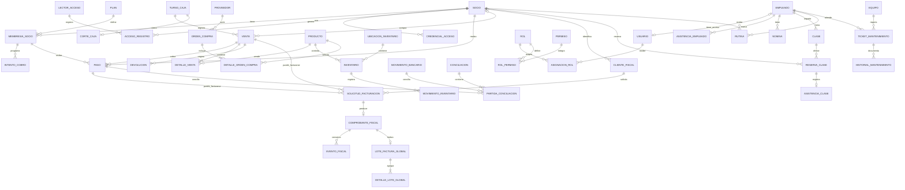

# Modelo de datos

## Principios del modelo

- Este diagrama es conceptual; nombres y cardinalidades deben convertirse en un esquema físico y migraciones antes de implementar.
- Cada entidad persistente usa identificador estable. Las fechas se almacenan en UTC y se presentan en la zona horaria del gimnasio.
- Los importes se guardan en centavos enteros o decimal exacto, nunca en `float`; cada monto conserva moneda.
- Los eventos históricos, pagos, accesos y comprobantes no se eliminan. Se conserva su estado y las relaciones de corrección o cancelación.
- Un intento de cobro no equivale a un pago confirmado; un pago confirmado tampoco equivale a un CFDI timbrado.
- El stock se explica con movimientos de inventario; cualquier saldo materializado debe poder reconciliarse contra esos movimientos.
- Los estados fiscales, cobros, ventas y accesos son dominios separados, aunque se relacionen mediante claves explícitas.

## Diagrama ER conceptual (Mermaid)

## Entidades por dominio

### Socios, membresías, pagos y acceso
- `Socio`, `Plan`, `MembresiaSocio`, `MetodoPago`, `IntentoCobro`, `Pago` y `ReintentoCobro` soportan el ciclo comercial y de cobro recurrente.
- `CredencialAcceso`, `LectorAcceso` y `AccesoRegistro` soportan credenciales, lecturas autorizadas/denegadas y sincronización offline.
- La plantilla biométrica cifrada se mantiene separada del registro de acceso; no se almacena imagen biométrica.

### Punto de venta e inventario
- `Producto`, `VarianteProducto`, `Inventario`, `UbicacionInventario` y `MovimientoInventario` modelan catálogo, existencias y trazabilidad de stock.
- `Venta`, `DetalleVenta`, `Devolucion`, `TurnoCaja` y `CorteCaja` modelan operaciones del mostrador y cierre por turno.
- `CuentaSocio` no almacena saldo: se calcula con ventas a cuenta, devoluciones abonadas y `CobroCuentaSocio`; el límite vive en `members.credit_limit_cents`.
- `EnvioEstadoCuenta` audita cada envío del estado de cuenta o recordatorio de cobranza (socio, usuario, destinatario, formato, propósito `statement`/`reminder`, fecha de corte, estado, error y `retry_of_id` cuando es un reintento). No es un movimiento de la cuenta y es append-only: reintentar agrega una fila nueva enlazada con la anterior (`20261019_0021`); el propósito y el índice por socio/propósito/fecha llegan con `20261021_0022`.
- `Proveedor`, `OrdenCompra` y `DetalleOrdenCompra` modelan el abastecimiento.

### Facturación y conciliación
- `ClienteFiscal`, `SolicitudFacturacion`, `ComprobanteFiscal` y `EventoFiscal` conservan datos fiscales, solicitud, resultado y auditoría del PAC. En el primer incremento fiscal se materializan como `member_fiscal_profiles`, `invoices` (solicitud y resultado en una fila) e `invoice_events`; separar la solicitud del comprobante queda para cuando el PAC real lo exija.
- `RelacionComprobante` vincula comprobantes corregidos, notas de crédito o cancelaciones sin borrar el original. Desde el cuarto incremento fiscal, una nota de crédito es una fila de `invoices` con `origin_type = "credit_note"` que apunta a la factura ajustada con `related_invoice_id`, registra el motivo y la nota, y conserva receptor, tasa e importes desglosados como cualquier comprobante.
- `LoteFacturaGlobal` y `DetalleLoteGlobal` se materializan desde el tercer incremento fiscal como la factura `origin_type = "global"` (periodo en `global_year`/`global_month`) y `global_invoice_sales`, que congela folio, fecha y total de cada venta incluida.
- `ComplementoPago` y `EventoComplementoPago` se materializan desde el quinto incremento fiscal como `invoice_payments` e `invoice_payment_events`: cada parcialidad de una factura PPD tiene folio, UUID y cancelación propios, conserva sus saldos y su XML, y no crea un segundo libro de cobros. La factura original no cambia de importe; su saldo se deriva de los complementos timbrados.
- `MovimientoBancario`, `Conciliacion` y `PartidaConciliacion` modelan la conciliación conceptual. El primer incremento materializa una versión **uno a uno**: `bank_accounts`, `bank_movements` y `bank_movement_events` vinculan cada línea del estado de cuenta con una sola operación interna (pago de membresía, venta, abono o devolución) y documentan la diferencia. Los depósitos agrupados, pagos divididos y partidas explícitas siguen siendo diseño futuro.

### Operación, personal y mantenimiento
- `Clase`, `ReservaClase`, `ListaEsperaClase` y `AsistenciaClase` registran agenda, cupo y participación.
- `Rutina` mantiene su relación con socio y entrenador.
- `Empleado`, `Usuario`, `Rol`, `Permiso`, `AsistenciaEmpleado`, `Nomina` y entidades relacionadas soportan personal, autorización y nómina.
- `Equipo`, `TicketMantenimiento` e `HistorialMantenimiento` registran disponibilidad, atención y costos técnicos.

## Relaciones importantes

- un socio puede tener varias membresías históricas; una sola puede habilitar acceso según las reglas vigentes
- cada `Pago` confirmado tiene un origen de cobro identificable: una membresía o una venta; los intentos fallidos se conservan como `IntentoCobro`
- una venta puede tener varios pagos (por ejemplo, pago dividido) y varias líneas; las líneas conservan descripción, precio e impuestos aplicados en el momento de venta
- cada solicitud de facturación refiere exactamente a una venta o a un pago; puede haber varios eventos/reintentos de PAC, pero no más de un CFDI vigente incompatible para el mismo origen
- una factura de ingreso puede tener varias notas de crédito parciales; la suma de las timbradas y no canceladas nunca excede su total, y una nota siempre refiere a una factura de ingreso existente
- una factura PPD puede tener varias parcialidades; solo las **timbradas** reducen su saldo y la suma nunca excede el total. Cada complemento refiere a una sola factura y solo la última parcialidad timbrada vigente se puede cancelar
- cada movimiento de inventario registra cantidad, ubicación, motivo y referencia de origen; el saldo actual no reemplaza el historial
- la factura global guarda el detalle de operaciones incluidas y evita duplicar las ya facturadas individualmente
- en el esquema implementado, una línea del banco se vincula con **una sola** operación interna y una operación interna con **una sola** línea viva; la conciliación agrupada (varios pagos por un depósito) y las partidas explícitas quedan como diseño futuro
- cada reserva pertenece a un socio y una clase; la asistencia se registra contra la reserva
- un usuario recibe roles con vigencia y contexto; cada acción sensible conserva actor y fecha en auditoría

## Reglas de integridad por definir en el esquema físico

- Restricción exclusiva de origen para `Pago` (membresía o venta) y para `SolicitudFacturacion` (pago o venta), con excepciones de factura global representadas por su detalle de lote.
- Unicidad de SKU por alcance definido, UUID de CFDI, referencia externa idempotente y reserva activa por socio/clase.
- Los cambios de estado de pago, acceso y comprobante se registran como eventos; no se sobrescriben de forma que se pierda el historial.
- Las operaciones offline deben incluir identificador idempotente del dispositivo/origen para evitar duplicados al sincronizar.
- La retención de documentos fiscales y datos personales se configura con validación legal y fiscal, no se deriva de este modelo conceptual.

⚠️ El modelo es una base de diseño, no un dictamen fiscal ni un esquema final de producción. Debe mantenerse consistente con el glosario y los documentos de módulo.

## Esquema físico inicial: socios y cobro recurrente

La migración inicial materializa únicamente el flujo prioritario de socios, planes y cobros. Los nombres físicos usan `snake_case` en inglés, conforme a la convención de código; las entidades del dominio conservan los términos del glosario.

| Tabla | Responsabilidad | Restricciones principales |
|---|---|---|
| `members` | identidad y contacto mínimo del socio | UUID, correo normalizado único cuando existe, estado de perfil separado del estado de membresía, `credit_limit_cents` nullable (`NULL` = sin tope, `>= 0`) |
| `plans` | configuración vendible de un plan | código único, duración positiva, importe en centavos y moneda |
| `memberships` | vigencia y estado del plan asignado | FKs restrictivas a socio/plan, periodo válido, estado controlado y máximo de una membresía no terminal por socio |
| `member_consents` | aceptación y revocación de documentos | historial con versión y fecha; no almacena datos médicos |
| `payment_methods` | referencia tokenizada del proveedor | token del proveedor cifrado, nunca PAN/CVV; un solo método predeterminado activo por socio |
| `payment_attempts` | cada intento de cobro e idempotencia | clave idempotente y huella de solicitud, número de intento positivo, estados controlados; un cobro manual con tarjeta declarada puede no tener `payment_method_id` ni proveedor |
| `payments` | cobros confirmados | un pago por intento exitoso, monto y moneda como snapshot; desde el cobro manual guarda periodo, turno de caja, cobrador y nota (los campos de periodo/turno son nulos en cobros de pasarela antiguos) |
| `payment_attempt_events` | historial de transiciones | eventos históricos vinculados al intento |
| `provider_webhook_events` | deduplicación y seguimiento de webhooks | evento único por proveedor, digest del payload y estado de procesamiento |
| `membership_events` | auditoría de cambios de membresía | estado anterior/nuevo, actor, fecha y metadatos sin secretos |

La migración está en `backend/alembic/versions/20261015_0001_memberships_billing.py`. La activación inicial de la membresía y la creación del pago confirmado deben ejecutarse en una sola transacción después de confirmar el pago; la respuesta HTTP de la pasarela por sí sola no es confirmación durable.

El cobro manual en mostrador (`20261021_0023_membership_manual_payments.py`) reutiliza `payment_attempts` y `payments` en vez de crear un libro paralelo: el intento queda `succeeded` con `provider = NULL` y el pago guarda `period_starts_at`, `period_ends_at`, `cash_session_id`, `collected_by` y `note`. El turno de caja no duplica el pago: al leer el corte suma los `payments` vinculados por `cash_session_id`, y solo el método `cash` entra al efectivo esperado.

## Esquema físico: facturación CFDI 4.0

La migración `20261023_0024_billing_cfdi.py` materializa el primer incremento fiscal, la `20261024_0025_global_invoices.py` el tercero, la `20261025_0026_credit_notes.py` el cuarto (notas de crédito) y la `20261025_0028_ppd_payments.py` el quinto (complementos de pago PPD). La solicitud y el comprobante comparten fila porque el estado distingue ambos momentos; el historial de intentos vive en `invoice_events`. Los complementos viven en dos tablas propias porque una factura PPD tiene varias parcialidades, cada una con su folio, UUID, XML y cancelación.

| Tabla | Responsabilidad | Restricciones principales |
|---|---|---|
| `member_fiscal_profiles` | datos fiscales del socio para prellenar la siguiente solicitud | un perfil por socio (`uq_member_fiscal_profiles_member`), RFC de 12–13 caracteres, FK restrictiva al socio |
| `invoices` | solicitud y resultado del CFDI, con snapshot del receptor, importes, timbrado y cancelación; también la factura global con su periodo, la nota de crédito con su relación y la factura PPD que se liquida con complementos | `origin_type` (`sale`/`membership_payment`/`global`/`credit_note`) y `status` (`requested`/`failed`/`stamped`/`cancelled`) con CHECK; `payment_method` (`PUE` por defecto o `PPD`; PPD usa `payment_form = '99'`); total positivo y `subtotal + impuesto = total`; `(series, folio)`, `idempotency_key` y `uuid` únicos; `request_fingerprint` de la solicitud; actor de alta, timbrado y cancelación; XML y referencias del PAC opcionales; `global_year`/`global_month` nulos salvo en `global` (`ck_invoices_global_period`); `related_invoice_id`, `credit_note_reason` y `credit_note_note` solo en `credit_note` (`ck_invoices_credit_note`), con FK autorreferente `RESTRICT` e índice `ix_invoices_related` |
| `invoice_items` | conceptos del comprobante con su parte gravable | posición y cantidad positivas, `subtotal + impuesto = total`, unicidad `(invoice_id, position)`, FK en cascada; el unitario de la global se deriva del subtotal entre la cantidad de operaciones |
| `invoice_events` | bitácora append-only de solicitudes, intentos y cancelaciones | tipo de evento, estado anterior/nuevo, actor, detalle JSON sin secretos y fecha; índice por factura y fecha |
| `global_invoice_sales` | trazabilidad de cada venta incluida en una factura global | unicidad `(invoice_id, sale_id)`, total positivo, FK en cascada a la factura y restrictiva a la venta; folio, fecha y total congelados; índices por factura y por venta |
| `invoice_payments` | una parcialidad (complemento de pago) de una factura PPD, con su folio, XML, saldos y cancelación | FK restrictiva a la factura; serie `P` por defecto; estados `requested`/`failed`/`stamped`/`cancelled`; `(series, folio)`, `idempotency_key` y `uuid` únicos; importe, parcialidad y folio positivos; `prior_balance > 0`, `amount <= prior_balance` y `outstanding = prior_balance − amount`; forma de pago real de dos caracteres; fecha de pago; tasa de IVA congelada; `request_fingerprint`; actores de alta, timbrado y cancelación; índices por factura/tiempo, factura/parcialidad y estado/tiempo |
| `invoice_payment_events` | bitácora append-only del complemento | evento (`payment_requested`/`payment_stamped`/`payment_stamp_failed`/`payment_cancelled`), estado anterior/nuevo, actor, detalle JSON sin secretos y fecha; FK en cascada al complemento e índice por complemento/fecha |

El índice único parcial `uq_invoices_active_origin` (`origin_type`, `origin_id` donde `status <> 'cancelled'` y `origin_type <> 'credit_note'`) impide dos facturas vivas para la misma venta o pago; cancelar conserva la fila y libera el origen para emitir la sustitución. Las notas de crédito quedan fuera del índice porque una factura admite varias parciales: su saldo —total de la factura menos notas timbradas y no canceladas— se controla en el servicio con `SELECT ... FOR UPDATE` sobre la factura original, tanto al crear como al timbrar. La nota apunta a la factura ajustada con `related_invoice_id` (FK autorreferente restrictiva), de modo que el comprobante relacionado no puede borrarse, y no crea tabla propia: sus conceptos viven en `invoice_items` y sus eventos en `invoice_events`. Para la global, `uq_invoices_active_global_period` (`global_year`, `global_month` donde la factura no está cancelada) impide dos globales vivas del mismo mes; la global usa un `origin_id` UUIDv5 determinista (`GLOBAL-YYYY-MM`) y la tabla `global_invoice_sales` impide además incluir la misma venta en dos globales vivas. El folio, la fecha y el total de la venta se copian al lote: cancelar o editar la factura global no reescribe la historia de la venta original. `invoices.uuid` es nulo en las facturas simuladas (no hay timbre del SAT) y se llena solo con un PAC real. El XML timbrado se guarda completo en `invoices.xml_content`; no hay tabla de archivos. La representación impresa (PDF) **no se almacena**: se genera al momento desde la factura, sus conceptos y el emisor, y solo se entrega para facturas timbradas o canceladas. Los envíos por correo no crean una tabla propia: se registran como eventos `invoice_email_sent`/`invoice_email_failed` en `invoice_events`, con destinatario, adjuntos (`pdf`, `xml`), estado de entrega y error. El emisor no se duplica en base de datos: se configura por entorno (`GYM_RFC`, `GYM_LEGAL_NAME`, `GYM_TAX_REGIME`, `GYM_POSTAL_CODE`, `CFDI_CERTIFICATE_NUMBER`, `CFDI_SERIES`, `CFDI_TAX_RATE_PERCENT`, `CFDI_PRODUCT_CODE`, `CFDI_SERVICE_CODE`).

El complemento de pago **no** modifica `invoices.total_cents`, no crea una fila en `payments` ni mueve caja: documenta fiscalmente una parcialidad que el operador declara. El saldo de una factura PPD es `total_cents − suma de complementos timbrados` (los cancelados no cuentan), y una solicitud `requested` o `failed` no lo consume; el timbrado bloquea la factura y el complemento, revalida el importe y recalcula `partiality_number`, `prior_balance_cents` y `outstanding_balance_cents`, de modo que las parcialidades timbradas quedan numeradas 1, 2, 3… sin huecos aunque se hayan registrado solicitudes fuera de orden. Solo se cancela la **última parcialidad timbrada vigente** y una factura con complementos timbrados no se cancela hasta cancelarlos; una factura PPD no acepta notas de crédito en esta versión. La FK restrictiva a `invoices` impide borrar una factura con complementos. El XML se guarda en `invoice_payments.xml_content` y la representación impresa se genera al momento desde el complemento y la factura; no hay tabla de archivos. Un complemento simulado deja `uuid` nulo y `is_simulated = true`. Los bloqueos `SELECT ... FOR UPDATE` son efectivos en PostgreSQL y no-op en SQLite, así que la garantía de saldo y numeración en concurrencia depende del motor de producción.

## Esquema físico: conciliación bancaria

La migración `20261025_0027_bank_reconciliation.py` agrega las cuentas, las líneas del estado de cuenta y su bitácora, además del permiso `finance.manage` para dueño y contador. La cuenta es un catálogo, no un libro: el «saldo» que muestra el panel es la suma de las líneas importadas.

| Tabla | Responsabilidad | Restricciones principales |
|---|---|---|
| `bank_accounts` | cuenta bancaria cuyas líneas se concilian | UUID, `lower(name)` único (`uq_bank_accounts_name_lower`), últimos cuatro dígitos (`account_last4`, longitud 4), moneda de tres letras, estado `active`/`inactive` con CHECK y `created_by` con FK `RESTRICT`; no guarda número completo, CLABE ni credenciales |
| `bank_movements` | una línea del estado de cuenta con signo | fecha, importe `BIGINT` distinto de cero, moneda, referencia y descripción; estado `pending`/`reconciled`/`difference`/`reviewing`; vínculo polimórfico `matched_source`/`matched_id` con CHECK de par completo, `reconciled` exige `matched_id`, `difference_cents` solo existe con vínculo y estado `difference`; unicidad `(bank_account_id, import_hash)`; índices por cuenta/fecha, estado y fecha; índices de actores con FK `RESTRICT` |
| `bank_movement_events` | bitácora append-only de la línea | `imported`/`matched`/`unmatched`/`flagged`/`reopened` con CHECK, detalle de hasta 400 caracteres, actor FK `RESTRICT`, fecha e índice por movimiento/fecha; no se actualiza ni se borra |

El índice único parcial `uq_bank_movements_match` sobre `(matched_source, matched_id)` donde `matched_id IS NOT NULL` impide que dos líneas del banco reclamen la misma operación interna. `matched_id` **no** es una FK real porque apunta a cuatro tablas distintas (`payments`, `sales`, `member_account_payments`, `sale_returns`); la existencia, el método electrónico, la moneda y el sentido del movimiento se validan en el servicio antes de vincular. Desvincular limpia el vínculo y devuelve la línea a `pending`, conservando el evento. El `import_hash` es SHA-256 de cuenta, fecha, importe, referencia y descripción (sin distinguir mayúsculas), de modo que reimportar el mismo estado no duplica; dos líneas legítimamente idénticas se consideran duplicadas. El `downgrade` de la migración se niega a ejecutarse si existen movimientos bancarios. Los bloqueos `SELECT ... FOR UPDATE` de las conciliaciones son efectivos en PostgreSQL y no-op en SQLite, así que la garantía de concurrencia en producción depende del motor. No hay eventos de auditoría para cambios de cuenta y no se permite borrar una cuenta con historial.

## Persistencia local de acceso offline

La primera implementación usa un archivo SQLite local para el caché de decisiones en el lector/controlador, separado de PostgreSQL central:

- `access_snapshots`: snapshot por socio con estado/vigencia, adeudo, horario y `valid_until`.
- `access_outbox`: decisiones autorizadas/denegadas con `event_id` único, lector, dirección, motivo, timestamp y estado `pending`/`synced`.
- Los eventos se insertan transaccionalmente y el mismo `event_id` con solicitud distinta se rechaza.
- El preview puede marcar eventos como sincronizados para probar el flujo; la integración real de transporte al backend y el hardware siguen pendientes.

## Identidad y autorización inicial

- `employees` mantiene el directorio operativo básico; `app_users` es la identidad de acceso y se vincula opcionalmente con un empleado.
- `roles`, `permissions` y `role_permissions` definen el catálogo RBAC granular `recurso.acción`.
- `user_role_assignments` conserva actor, fecha, vencimiento y revocación de cada asignación.
- `user_sessions` almacena solo SHA-256 del token opaco, con vencimiento y revocación server-side.
- `auth_events` registra login exitoso/fallido, logout, creación de usuario y cambios de rol sin guardar contraseñas ni tokens.
- Los roles predeterminados se siembran en la migración Alembic; MFA, rate limiting, recuperación de contraseña y nómina no forman parte de esta primera revisión.
