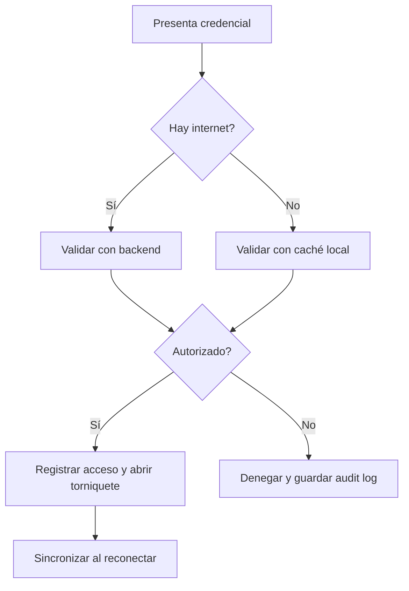

# Acceso con y sin internet

## Resumen

El control de acceso debe operar tanto con conectividad activa como con cortes de red.

## Reglas clave
- las entradas usan un snapshot local con vencimiento explícito; un snapshot ausente o vencido deniega la entrada
- la decisión valida membresía, adeudo bloqueante, horario local, antipassback, límite de visitas y aforo
- las salidas no se bloquean por estado de membresía o falta de caché
- toda decisión, autorizada o denegada, se guarda en el outbox local con identificador idempotente
- el outbox solo marca un evento sincronizado después de recibir confirmación del servidor
- la respuesta deseada del lector es menor a 1 segundo

## Flujo de sincronización

1. El controlador evalúa la credencial contra el snapshot local vigente.
2. Registra localmente la decisión y abre o mantiene cerrado el acceso según el resultado.
3. Al recuperar conectividad, envía lotes de eventos pendientes usando su `event_id` como referencia idempotente.
4. El servidor valida duplicados y devuelve los eventos aceptados.
5. El controlador marca como sincronizados solo los identificadores confirmados; los demás permanecen en cola.

La vista previa actual implementa la evaluación y el outbox SQLite, pero no el lector físico ni la API de sincronización.

## KPIs
- tasa de sincronización exitosa
- tiempo de respuesta del acceso
- porcentaje de accesos offline
