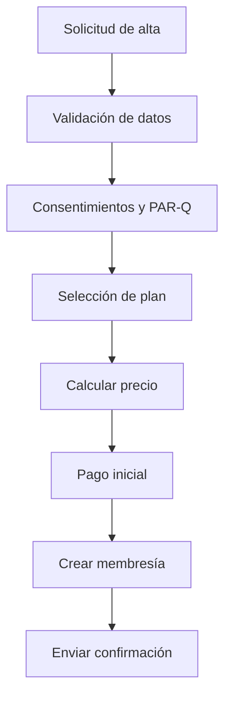

# Alta de socio y primer pago

## Resumen

Este proceso cubre el registro del socio, consentimiento de privacidad, firma digital, selección de plan y primer cobro.

## Pasos
1. El socio aporta datos personales y de contacto.
2. Recepción valida documentos y foto.
3. Se firma consentimiento de privacidad.
4. Se asigna plan y promociones aplicables.
5. Se ejecuta cargo inicial con token de pasarela.
6. Se activa la membresía y se registra en historial.

## Reglas clave
- la membresía no se activa si falta consentimiento
- el primer pago es idempotente
- el registro queda auditable

## KPIs
- tiempo de alta
- tasa de completitud correcta
- tasa de primer pago exitoso

## Estado de implementación

- Los pasos de datos personales y consentimiento ya se ejecutan desde el panel: `POST /admin/members` crea al socio en estado `pending` y registra el consentimiento de privacidad (versión `privacidad-v1`).
- El **primer cobro manual** ya se ejecuta desde la ficha del socio: `POST /admin/members/{id}/membership/payments` exige un turno de caja abierto, registra el pago (`cash`/`card`/`transfer` como declarado), activa al socio y crea la membresía con su periodo. Es idempotente por `idempotency_key` y deja `PaymentAttempt`, `Payment`, evento de membresía y vínculo al turno. La migración es `20261021_0023`.
- La renovación usa el mismo endpoint: si el socio ya tiene una membresía `active`, extiende desde `max(ahora, ends_at)` y conserva el plan actual si no se envía otro. También se pueden editar los datos del socio (`PATCH /admin/members/{id}`) y congelar, reanudar o cancelar la membresía con motivo.
- La **activación sin cobro** (`POST /admin/members/{id}/membership`) sigue disponible como cortesía auditada (`no_charge: true`), con confirmación en el panel. No sustituye al cobro normal.
- La pasarela real y el cobro recurrente automático siguen pendientes: el flujo de tokenización, reintentos automáticos y webhooks existe en backend, pero no se conecta a un proveedor real. El cobro manual se registra como declarado; la tarjeta no se autoriza contra una terminal.
- Cuando la pasarela esté conectada, el alta con tarjeta podrá volver al camino `pending_payment` → cobro confirmado → `active`, mientras el cobro manual seguirá disponible para efectivo y transferencia.
