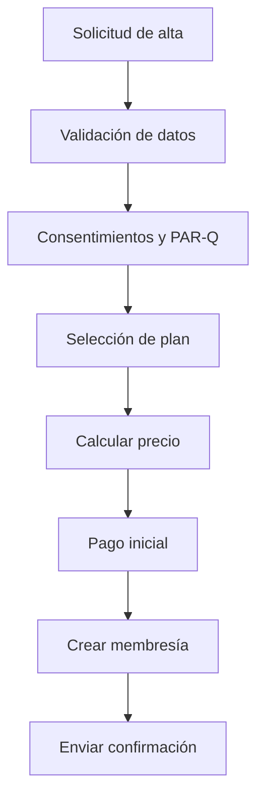

# Alta de socio y primer pago

## Resumen

Este proceso cubre el registro del socio, consentimiento de privacidad, firma digital, selección de plan y primer cobro.

## Pasos
1. El socio aporta datos personales y de contacto.
2. Recepción valida documentos y foto.
3. Se firma consentimiento de privacidad.
4. Se asigna plan y promociones aplicables.
5. Se ejecuta cargo inicial con token de pasarela.
6. La membresía se activa y se registra en el historial solo después de confirmar el pago.

### Cuando el pago se inicia en línea

El socio autenticado puede iniciar `POST /member/membership/checkout` con `plan_id` y `Idempotency-Key`. El backend crea un checkout alojado de Conekta para tarjeta en sandbox, tomando precio y moneda del plan, y devuelve `checkout_url`. Reutilizar la misma clave devuelve el mismo checkout o reintenta la misma orden; no crea un segundo intento. Se requiere `CONEKTA_MODE=sandbox` y configurar credenciales y URL de retorno HTTPS por entorno.

Al consultar `GET /member/membership/plans`, el socio también recupera su checkout pendiente, si existe. La respuesta incluye el plan, la clave idempotente y la URL ya guardada (si la orden aún no la tiene, la app puede reintentar con la misma clave). Esto permite continuar después de cerrar o reiniciar la app; el dato está acotado al socio autenticado y no cambia la elegibilidad para iniciar otra membresía.

La creación del checkout y el retorno a la app no confirman el pago. Conekta notifica el resultado en `POST /webhooks/conekta/membership`; el backend verifica la firma `Digest`, `livemode=false`, el ID de orden, importe, moneda y estado antes de procesarlo idempotentemente. Solo eventos pagados verificados crean `Payment` y activan la membresía. Un rechazo mantiene el intento fallido y una discrepancia queda registrada para revisión sin activar el acceso. El endpoint requiere `CONEKTA_WEBHOOK_PUBLIC_KEY` de sandbox. No se permite producción ni se habilitan SPEI/efectivo en el checkout actual.

## Reglas clave
- la membresía no se activa si falta consentimiento
- el primer pago es idempotente
- el registro queda auditable
- la confirmación en línea depende del webhook verificado, no de la redirección del checkout

## KPIs
- tiempo de alta
- tasa de completitud correcta
- tasa de primer pago exitoso

## Estado de implementación

- Los pasos de datos personales y consentimiento ya se ejecutan desde el panel: `POST /admin/members` crea al socio en estado `pending` y registra el consentimiento de privacidad (versión `privacidad-v1`).
- El **primer cobro manual** ya se ejecuta desde la ficha del socio: `POST /admin/members/{id}/membership/payments` exige un turno de caja abierto, registra el pago (`cash`/`card`/`transfer` como declarado), activa al socio y crea la membresía con su periodo. Es idempotente por `idempotency_key` y deja `PaymentAttempt`, `Payment`, evento de membresía y vínculo al turno. La migración es `20261021_0023`.
- La renovación usa el mismo endpoint: si el socio ya tiene una membresía `active`, extiende desde `max(ahora, ends_at)` y conserva el plan actual si no se envía otro. También se pueden editar los datos del socio (`PATCH /admin/members/{id}`) y congelar, reanudar o cancelar la membresía con motivo.
- La **activación sin cobro** (`POST /admin/members/{id}/membership`) sigue disponible como cortesía auditada (`no_charge: true`), con confirmación en el panel. No sustituye al cobro normal.
- El cobro manual se registra como declarado; la tarjeta no se autoriza contra una terminal.
- El checkout alojado y su webhook están implementados y limitados a sandbox. La prueba E2E con Conekta se completó el 2026-10-31 con un pago de $10 MXN: el webhook firmado se validó, el intento terminó en `succeeded` y la membresía en `active`. Solo el webhook confirma el pago; la ruta de retorno no activa la membresía. Sigue pendiente la conciliación operativa y la aprobación del responsable.
- ADR-066 mantiene como condición de producción la verificación de webhooks, la conciliación y la aprobación del negocio. La renovación automática y guardar métodos de pago no forman parte del primer incremento.
- El cobro manual seguirá disponible para efectivo, tarjeta declarada y transferencia aunque se integre el checkout en línea.
