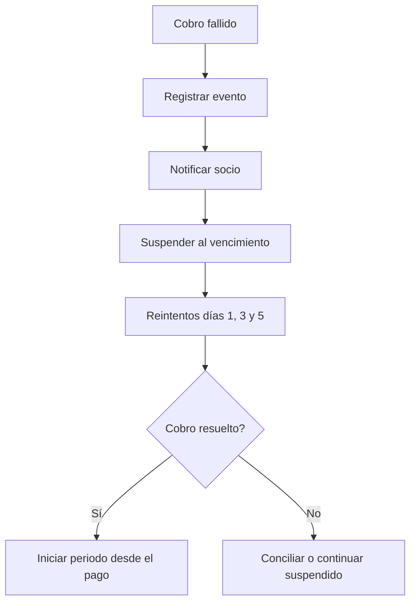

# Cobro fallido, reintentos y suspensión

## Resumen

El proceso gestiona los fallos de pago cuando el cobro recurrente no tiene éxito y la membresía queda en estado de riesgo.

## Pasos
1. La pasarela devuelve rechazo o error.
2. Se registra la causa y el intento.
3. Se notifican alertas.
4. Se reintenta 1, 3 y 5 días después del vencimiento. No hay periodo de
   gracia: el acceso se suspende al vencer la membresía.
5. Si el cobro se recupera, el nuevo periodo comienza en la fecha efectiva del
   pago; un resultado desconocido requiere conciliación y no genera un cargo
   nuevo.

## KPIs
- tasa de recuperación
- tiempo medio de resolución
- porcentaje de miembros suspendidos
