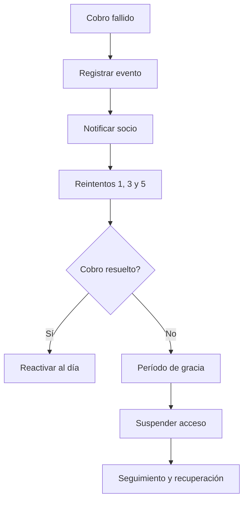

# Cobro fallido, reintentos y suspensión

## Resumen

El proceso gestiona los fallos de pago cuando el cobro recurrente no tiene éxito y la membresía queda en estado de riesgo.

## Pasos
1. La pasarela devuelve rechazo o error.
2. Se registra la causa y el intento.
3. Se notifican alertas.
4. Se ejecuta política de reintentos y gracia.
5. Si no se resuelve, se suspende la membresía según política del negocio.

## KPIs
- tasa de recuperación
- tiempo medio de resolución
- porcentaje de miembros suspendidos
