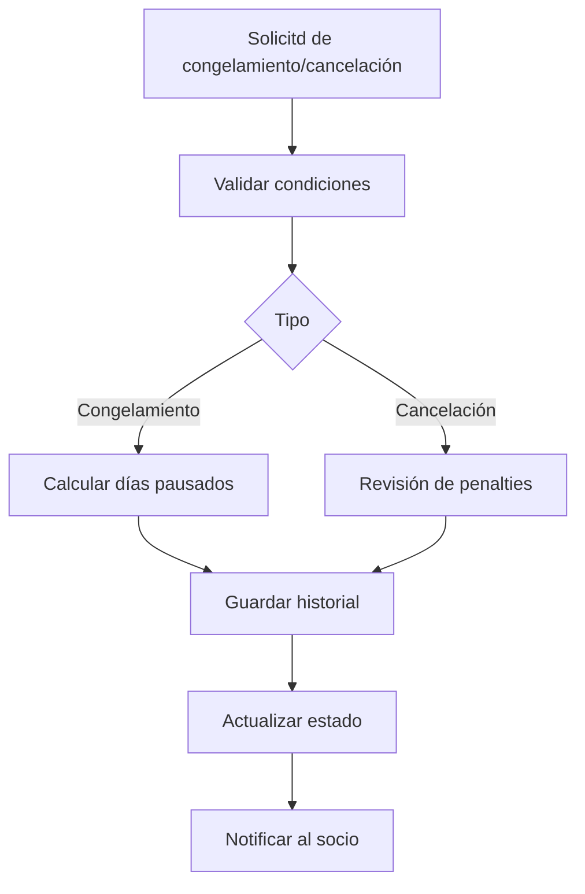

# Congelamiento y cancelación

## Resumen

Este proceso permite pausar o terminar la membresía siguiendo reglas de prorrateo y comunicación.

## Reglas clave
- congelamiento requiere fecha de inicio y fin
- cancelación requiere crédito o reason code
- historial no se borra ni se sobrescribe

## KPIs
- tasa de no-renovación por cancelación
- duración del congelamiento
- porcentaje de solicitudes atendidas a tiempo

## Estado de implementación

- El congelamiento, la reanudación y la cancelación ya se ejecutan desde la ficha del socio (permiso `members.manage`): `POST /admin/members/{id}/membership/freeze`, `/resume` y `/cancel`.
- **Primera versión:** el congelamiento solo cambia el estado (`active`↔`frozen`); todavía no calcula ni extiende la vigencia por los días pausados (no hay fecha de fin de congelamiento).
- La cancelación exige un motivo no vacío y deja la membresía en `cancelled`, liberando al socio para una nueva alta. Cada transición registra su evento de membresía con el actor responsable; el historial no se borra.
- Quedan pendientes: prorrateo/penalización por cancelación, extensión de vigencia por congelamiento y las notificaciones al socio (WhatsApp, push, correo).
