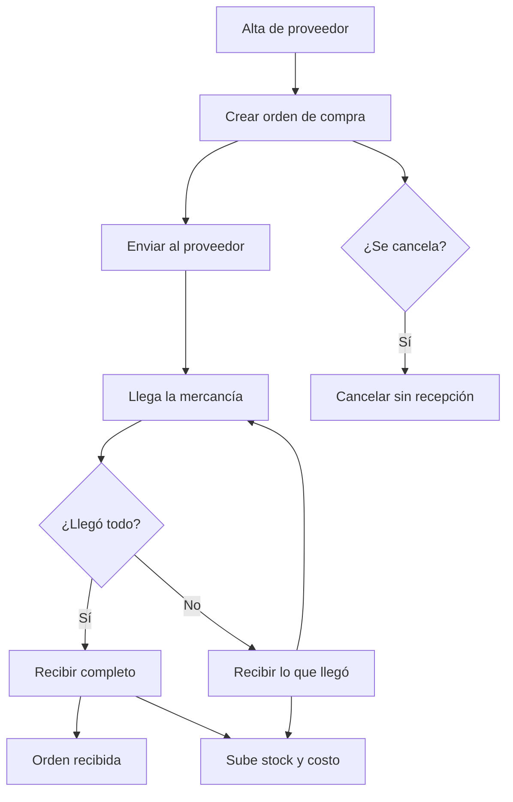

# Reabastecimiento de inventario

## Resumen

Este proceso cubre la mitad entrante del inventario: dar de alta al proveedor, pedirle mercancía con una orden de compra, enviarla, recibir lo que realmente llega (completo o parcial) y ver cómo el stock y el costo de reposición se actualizan. Es el complemento natural de la venta en mostrador: lo que sale por el POS se repone por aquí.

## Pasos
1. Gerente (o quien tenga `inventory.manage`) registra al proveedor (`POST /admin/suppliers`) con nombre único, contacto, teléfono, correo y notas.
2. Crea la orden de compra (`POST /admin/purchase-orders`) eligiendo proveedor activo, líneas de producto con cantidad y costo unitario, fecha estimada y notas. El sistema genera el folio `OC-…` (con la **fecha del día local del gimnasio**).
3. Cuando la orden está lista se envía (`POST /admin/purchase-orders/{id}/send`) y queda en estado `sent`.
4. Llega la mercancía: se registra la recepción (`POST /admin/purchase-orders/{id}/receive`) con la cantidad real por línea.
5. El sistema sube el `inventory_stock` con un movimiento de tipo `intake`, actualiza la cantidad recibida de la línea y refresca el costo de reposición del producto con el último costo recibido.
6. Si llegó todo, la orden pasa a `received` y registra quién y cuándo. Si llegó parcial, queda abierta con el pendiente visible para completarla en otra entrega.
7. Si el proveedor no puede surtir nada, la orden se cancela (`POST /admin/purchase-orders/{id}/cancel`), pero **solo** mientras no se haya recibido mercancía.

## Reglas clave
- Un producto no puede repetirse en la misma orden y cada cantidad debe ser positiva.
- No se puede recibir más de lo pedido en una línea, ni registrar una línea que no pertenezca a la orden.
- Una recepción parcial **no** cierra la orden: el pendiente se conserva y puede completarse después.
- Recibir sube el stock y **no** reescribe la orden original salvo la cantidad recibida y el estado.
- Una orden con mercancía recibida no se puede cancelar. El resumen de órdenes excluye las canceladas del valor comprometido.
- Un proveedor inactivo conserva su historial pero no acepta órdenes nuevas.
- Todos los montos se manejan en centavos enteros; el total es la suma de `cantidad × costo unitario`.

## KPIs
- órdenes por estado (creadas, enviadas, recibidas, canceladas)
- valor comprometido en órdenes abiertas
- exactitud de la entrega (recibido vs. pedido por línea)
- costo de reposición promedio por producto

## Estado de implementación

- El alta de proveedores, la creación/envío/cancelación de órdenes y la recepción (completa o parcial) ya se ejecutan desde el backend y el panel web (vista Inventario, pestaña «Compras») con los permisos `inventory.read`/`inventory.manage`. No se creó ningún permiso nuevo.
- La recepción reutiliza el tipo de movimiento `intake` marcado con `reference_type = "purchase_order"` en lugar de un tipo `purchase` propio, para no alterar el `CHECK` de `inventory_movements.movement_type` (la vista previa usa `create_all`, que no altera tablas existentes).
- Quedan pendientes el IVA/retenciones y el CFDI de compras, el cotejo contra la factura del proveedor, la entrada directa sin orden y las cuentas por pagar: recibir sube stock y costo, pero todavía no genera una obligación financiera.
