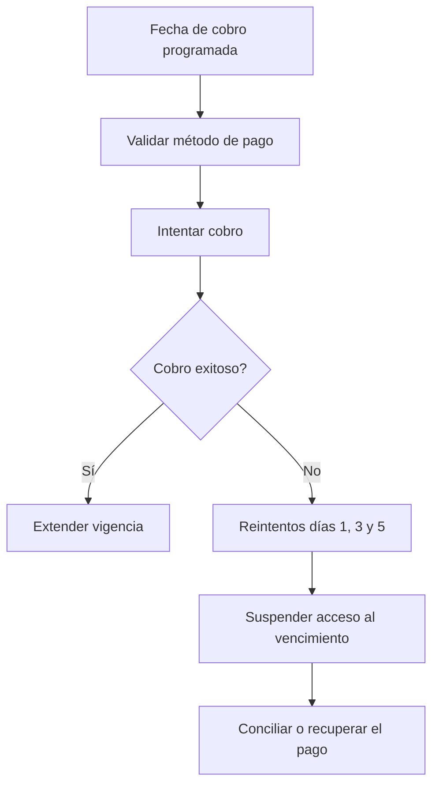

# Renovación y cobro recurrente

## Resumen

La renovación se programa en el backend con un método de pago tokenizado, un
consentimiento vigente y una política de reintentos definida.

## Pasos
1. Se calcula la fecha de renovación automática.
2. Se valida token de la pasarela.
3. Se intenta el cobro según política.
4. Si falla, se reintenta 1, 3 y 5 días después del vencimiento. El acceso se
   suspende desde la fecha de vencimiento; no hay periodo de gracia.
5. Si un reintento cobra, el nuevo periodo empieza en la fecha efectiva del
   pago y dura los días definidos por el plan.

## Reglas clave
- no se guarda la tarjeta del socio
- reintentos: 1, 3 y 5 días
- no hay periodo de gracia; el acceso se suspende en la fecha de vencimiento
- se exige consentimiento explícito y revocable antes de conservar el método
- el acceso se suspende al vencer, aunque sigan programados los reintentos
- un resultado desconocido requiere conciliación y no genera un cargo nuevo

## Decisiones acordadas (ADR-087)

- El backend controla el calendario; Conekta tokeniza y procesa cada cargo.
- La tarjeta se captura en el tokenizador web de Conekta, abierto desde la app.
- Se conserva la referencia de pago cifrada; no se guarda PAN ni CVV.
- Para socios con un periodo ya pagado, el consentimiento no genera un cargo
  ni guarda una tarjeta inmediatamente. En la fecha de vencimiento, el socio
  completa la captura/tokenización y ese primer cobro corresponde a la
  renovación normal; los siguientes ciclos podrán automatizarse.
- El modo productivo permanece deshabilitado hasta revisión y autorización.

## Estado de implementación

- Política aprobada: cobro local, reintentos 1/3/5 días, sin gracia y periodo
  renovado desde la fecha efectiva del pago.
- El consentimiento auditable desde la app está implementado. Al vencer el
  periodo, la app abre un enlace de un solo uso para el tokenizador web; al
  confirmar la captura, el backend guarda la referencia cifrada y solicita el
  primer cobro normal. La renovación queda `pending_payment` hasta el webhook
  firmado de Conekta. La captura y el cargo están cubiertos con simulaciones;
  falta la prueba E2E real de sandbox.
- El scheduler de ciclos posteriores, los reintentos 1/3/5, la suspensión
  automática y la conciliación de resultados desconocidos siguen pendientes.
  Producción continúa deshabilitada.

## KPIs
- tasa de renovación
- tasa de fallo por tarjeta
- tiempo al cobro exitoso
