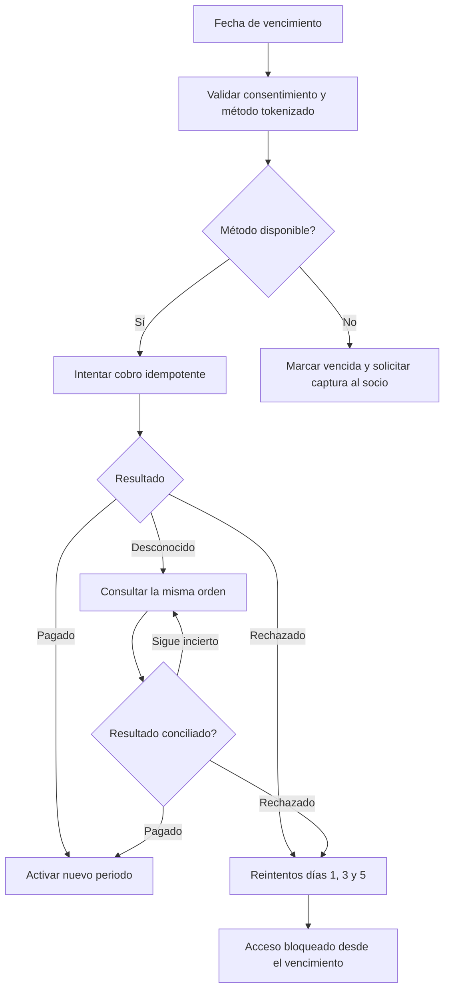

# Renovación y cobro recurrente

## Resumen

El backend ejecuta las renovaciones con un consentimiento vigente y, para los
ciclos posteriores a la captura inicial, un método de pago Conekta tokenizado y
activo. La tarea del host procesa vencimientos, reintentos y conciliación cada
15 minutos por defecto.

## Pasos
1. `backend/run_membership_renewals.py`, instalado por `backend/ops_cron.py`,
   busca membresías vencidas y ejecuciones atrasadas cada 15 minutos. La
   configuración permite cambiar intervalo y límite por pasada.
2. Se comprueba que la autorización no haya sido revocada y que el plan y el
   método de pago guardado sigan disponibles. Sin método, la membresía vence y
   el socio debe completar la captura inicial desde la app. Si el plan fue
   desactivado o ya no tiene precio cobrable, no se hace el cargo, se desactiva
   la renovación automática y se registra el motivo.
3. Con método activo se crea el siguiente ciclo y se intenta el cargo con una
   clave idempotente estable. La membresía nueva queda `pending_payment` hasta
   confirmar el pago.
4. Un rechazo definitivo permite reintentos en los días locales 1, 3 y 5 tras
   el vencimiento. Si una pasada se retrasó, también se respeta el intervalo
   mínimo entre intentos para evitar cargos consecutivos.
5. Si la respuesta es incierta, se consulta la misma orden Conekta. No se crea
   otro intento mientras no se conozca el resultado. Una orden pagada activa el
   periodo; un rechazo conciliado vuelve a la política de reintentos.
6. El acceso se bloquea desde `ends_at`, independientemente de que el cron haya
   actualizado ya el estado. Un pago confirmado inicia el nuevo periodo en la
   fecha efectiva del pago y por la duración del plan.

## Reglas clave
- no se guarda la tarjeta del socio
- reintentos: 1, 3 y 5 días
- no hay periodo de gracia; el acceso se suspende en la fecha de vencimiento
- se exige consentimiento explícito y revocable antes de conservar el método
- el acceso se suspende al vencer, aunque sigan programados los reintentos
- los cobros desconocidos se concilian contra la misma orden y no generan otro
  cargo mientras el resultado siga sin resolver
- los estados terminales de un intento no se reabren por una respuesta tardía

## Decisiones acordadas (ADR-087)

- El backend controla el calendario; Conekta tokeniza y procesa cada cargo.
- La tarjeta se captura en el tokenizador web de Conekta, abierto desde la app.
- Se conserva la referencia de pago cifrada; no se guarda PAN ni CVV.
- Para socios con un periodo ya pagado, el consentimiento no genera un cargo
  ni guarda una tarjeta inmediatamente. En la fecha de vencimiento, el socio
  completa la captura/tokenización y ese primer cobro corresponde a la
  renovación normal; los siguientes ciclos podrán automatizarse.
- El modo productivo permanece deshabilitado hasta revisión y autorización.

## Estado de implementación

- Política aprobada: cobro local, reintentos 1/3/5 días, sin gracia y periodo
  renovado desde la fecha efectiva del pago.
- El consentimiento auditable desde la app está implementado. Al vencer el
  periodo, la app abre un enlace de un solo uso para el tokenizador web; al
  confirmar la captura, el backend guarda la referencia cifrada y solicita el
  primer cobro normal. La renovación queda `pending_payment` hasta el webhook
  firmado de Conekta. La captura y el cargo están cubiertos con simulaciones;
  falta la prueba E2E real de sandbox.
- El proceso `run_membership_renewals.py` vence ciclos, crea el siguiente
  intento, aplica reintentos 1/3/5 y concilia órdenes pendientes o desconocidas;
  `ops_cron.py` lo programa cada 15 minutos por defecto.
- La integración Conekta consulta órdenes en sandbox y procesa confirmaciones y
  rechazos firmados. Los resultados inciertos conservan el mismo intento. Las
  pruebas son simuladas; falta una corrida E2E del ciclo recurrente con la
  cuenta sandbox responsable. Producción continúa deshabilitada.

## KPIs
- tasa de renovación
- tasa de fallo por tarjeta
- tiempo al cobro exitoso
