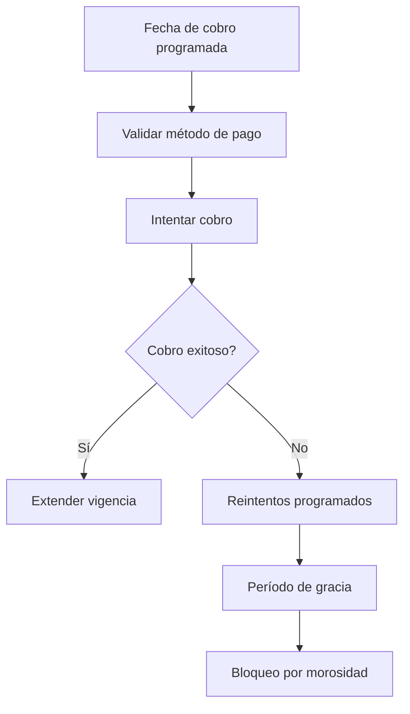

# Renovación y cobro recurrente

## Resumen

La renovación ocurre automáticamente con método de pago registrado y política de reintentos.

## Pasos
1. Se calcula la fecha de renovación automática.
2. Se valida token de la pasarela.
3. Se intenta el cobro según política.
4. Si falla, se reintenta y se comunica al socio.
5. Si se resuelve, la vigencia se actualiza.

## Reglas clave
- no se guarda la tarjeta del socio
- reintentos: 1, 3 y 5 días
- el acceso se bloquea solo si aplica la política definid

## KPIs
- tasa de renovación
- tasa de fallo por tarjeta
- tiempo al cobro exitoso
