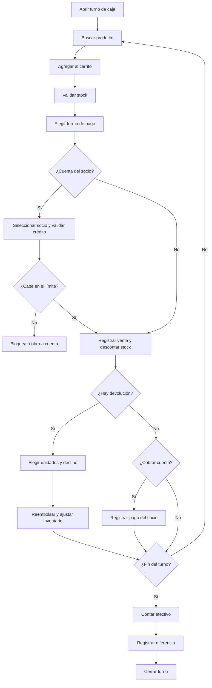

# Venta en mostrador y corte de caja

## Resumen

Este proceso cubre la operación de caja del gimnasio: abrir el turno, vender productos o accesorios en mostrador, cobrar, registrar devoluciones o mermas si hace falta y cerrar el turno con el corte correspondiente.

## Pasos
1. Recepción (o gerente) abre el turno con el fondo de caja inicial (`POST /admin/cash-sessions`).
2. Se busca el producto por nombre, SKU o código de barras en el catálogo.
3. Se agregan cantidades al carrito; el sistema valida que haya stock suficiente.
4. Se elige la forma de pago (`cash`, `card`, `transfer` o `account`) y se registra la venta (`POST /admin/sales`). Con `account` se selecciona al socio: el sistema valida que el nuevo saldo no supere su límite de crédito (`NULL` = sin tope; `409` si lo excede), el importe se carga a su cuenta y **no** entra al efectivo, tarjeta ni transferencia del turno. El panel muestra el crédito disponible y deshabilita «Cargar a cuenta» si el carrito lo excede.
5. El sistema genera el folio (con la **fecha del día local del gimnasio**), descuenta el inventario y guarda el movimiento de tipo `sale`.
6. Si se cae la red, el panel guarda la venta en una cola local con su fecha real (`localStorage`, solo efectivo/tarjeta/transferencia) y la envía al reconectar con `POST /admin/sales/offline`. La sincronización es idempotente y muestra el resultado por venta; el cierre del turno queda bloqueado mientras haya pendientes.
7. Si un socio regresa un producto se abre la devolución desde la venta original (`POST /admin/sales/{id}/returns`): se eligen las unidades, el destino de cada una (reingreso a stock o merma) y el motivo.
8. El sistema genera el folio `D-…`, reembolsa con la forma elegida y ajusta el inventario: `return` positivo para lo que se reingresa y `return` + `waste` para la merma. La venta original no se reescribe. Si la venta fue a cuenta, el reembolso se abona **siempre** a la cuenta del socio (`refund_method = "account"`), nunca en efectivo.
9. Los cobros de la cuenta se registran con `POST /admin/member-accounts/{member_id}/payments`, requieren un turno abierto y quedan vinculados a él; un pago en efectivo sube el efectivo esperado y uno con tarjeta o transferencia solo reduce la cuenta por cobrar. Los cobros manuales de membresía (`POST /admin/members/{member_id}/membership/payments`) siguen la misma regla: exigen turno abierto, se vinculan a él y solo su parte en efectivo sube el efectivo esperado.
10. Un dueño o gerente puede fijar o quitar el límite del socio (`PATCH /admin/member-accounts/{member_id}/credit-limit`, permiso `sales.credit`) desde «Cuentas por cobrar», incluso si el socio aún no tiene saldo. La pestaña muestra la antigüedad del saldo (0–30, 31–60, 61–90 y +90 días) y permite filtrar a los socios sobre límite; bajar el límite no perdona la deuda, solo bloquea nuevos cargos hasta cobrar o ampliarlo.
11. Desde el mismo estado de cuenta se descarga el corte en PDF o CSV (`GET /admin/member-accounts/{member_id}/statement.pdf|.csv`, permiso `sales.read`) o se envía al correo del socio (`POST /admin/member-accounts/{member_id}/statement/send`, permiso `sales.manage`). Sin correo responde `422`; en vista previa el envío se registra como `simulated` y no sale del sistema. Cada intento queda en `member_account_statement_deliveries`.
12. El historial del estado de cuenta (`GET .../statement/deliveries`, permiso `sales.read`) muestra los intentos con destinatario, formato, propósito, corte, estado, usuario y error. Si un intento quedó `failed` o `simulated`, se puede reintentar (`POST .../deliveries/{delivery_id}/retry`, permiso `sales.manage`): se conservan destinatario, formato, propósito y corte, y se agrega una fila nueva enlazada con `retry_of_id`. Un envío `sent` no se reintenta desde el historial (`409`).
13. Para cobrar saldos vencidos, «Cuentas por cobrar» abre «Recordatorios»: se seleccionan socios con cargos de más de 30 días, se elige PDF/CSV, se confirma el lote y se envía `POST /admin/member-accounts/reminders` (permiso `sales.manage`). La API procesa hasta 50 socios por separado y devuelve el resultado de cada uno; los socios sin correo, sin saldo vencido o con un recordatorio exitoso en los últimos 7 días se omiten, y un fallo de transporte no cancela los demás.
14. Al terminar el turno se cuenta el efectivo y se cierra (`POST /admin/cash-sessions/{id}/close`), explicando cualquier diferencia.

## Reglas clave
- No se puede vender sin un turno de caja abierto ni sin stock suficiente.
- El descuento de stock es atómico: dos ventas simultáneas del mismo SKU nunca dejan el saldo en negativo.
- Cada descuento deja un movimiento de inventario conciliable con el saldo.
- Tampoco se puede devolver sin turno abierto, sin motivo ni por más unidades de las vendidas menos las ya devueltas.
- Una devolución **reingresa** el producto al stock o lo da de baja como **merma**; en ambos casos el historial conserva el movimiento y el ledger cuadra contra el saldo.
- Las ventas de **servicio** —el extra de una clase premium, cobrado al marcar asistencia— no pasan por la devolución de producto: se reembolsan desde la venta con `POST /admin/sales/{id}/service-refund` y el permiso `sales.service_refund` (solo dueño y gerente). La devolución es total, no toca inventario ni la reserva, sale del turno abierto que la paga y deja la venta `refunded`; repetirla responde `409`.
- Una venta a cuenta exige un socio activo y se salda con pagos que no pueden superar el saldo pendiente.
- El cargo a cuenta respeta el límite del socio: se acepta solo si `saldo + venta <= límite`. Sin límite (`NULL`) no hay tope; un límite `0` bloquea todos los cargos. Un intento que excede responde `409` y no descuenta stock.
- Si el límite se reduce por debajo del saldo, la cuenta queda **sobre límite** y se bloquean nuevos cargos, pero la deuda existente se conserva.
- La antigüedad del saldo aplica pagos y devoluciones **FIFO** a los cargos más antiguos; los tramos 0–30, 31–60, 61–90 y +90 días suman el saldo positivo y se calculan al consultar, no se almacenan.
- Una venta sin conexión se guarda con un identificador único del dispositivo; reintentar la sincronización no duplica el cobro ni el stock. Sin red no se puede cargar a cuenta ni devolver productos.
- Las ventas sin conexión se vinculan al turno abierto al sincronizar; el cierre se bloquea mientras la cola local tenga pendientes.
- El turno se cierra con el efectivo esperado (fondo + ventas en efectivo − devoluciones en efectivo + cobros de cuenta en efectivo + cobros de membresía en efectivo); si la diferencia no es cero, se exige una explicación. Los cobros de membresía con tarjeta o transferencia se registran como declarados y no entran al efectivo esperado.
- Los totales POS (`VENTAS`/`TOTAL` del turno y de los cortes) cuentan solo ventas de productos; los cobros de membresía se muestran en su propio indicador `MEMBRESÍAS` y solo su parte en efectivo afecta el arqueo.
- El estado de cuenta se genera al momento (no se almacena el archivo) y solo se descarga o envía con los permisos indicados; el envío no altera el saldo ni el turno. El historial es append-only y un reintento crea una fila nueva enlazada con `retry_of_id`; solo se reintentan intentos `failed` o `simulated`. Los recordatorios de cobranza también son append-only (`purpose = reminder`), no modifican el saldo y respetan un cooldown de 7 días por socio.
- Todos los montos se manejan en centavos enteros.

## KPIs
- ticket promedio por venta
- diferencia de caja por turno
- ventas por forma de pago
- devoluciones por motivo y merma acumulada
- rotación de inventario

## Estado de implementación

- Abrir/cerrar turno, registrar ventas, devolver productos y descontar inventario ya se ejecutan desde el backend y el panel web (vista Inventario) con los permisos `sales.read`/`sales.manage` e `inventory.read`/`inventory.manage`.
- El cobro es local: **no hay terminal bancaria conectada**. Las formas de pago `card` y `transfer` se registran como declaradas por el operador, sin confirmación de la pasarela. La integración real con Conekta y la terminal sigue pendiente.
- Las devoluciones ya se netean en los reportes financieros: el mostrador resta los reembolsos por el periodo en que se pagaron (base de caja) y expone brutos, devoluciones y neto.
- La venta a cuenta del socio ya está implementada: el cargo se registra en la venta, el saldo se calcula como cargos − devoluciones abonadas − pagos, los cobros se vinculan al turno y el estado de cuenta se consulta en la pestaña «Cuentas por cobrar».
- El cobro manual y la renovación de membresía ya están implementados: la ficha del socio registra efectivo, tarjeta declarada o transferencia, exige turno abierto y crea/renueva la membresía; el turno muestra los cobros de membresía y solo el efectivo afecta el arqueo.
- La operación sin conexión ya está implementada: el POS cachea catálogo y turno en el navegador, encola las ventas con un `client_reference` único, sincroniza por lote al reconectar (idempotente, con resultado por venta) y bloquea el cierre del turno mientras haya pendientes.
- El límite de crédito y la antigüedad de saldos ya están implementados: `members.credit_limit_cents` (`NULL` = sin tope, `0` = sin crédito) se valida en cada cargo a cuenta, las cuentas sobre límite quedan bloqueadas y la pestaña «Cuentas por cobrar» muestra los tramos 0–30/31–60/61–90/+90 con pagos y devoluciones aplicados FIFO. Fijar el límite exige `sales.credit` (dueño y gerente).
- El estado de cuenta exportable ya está implementado: PDF/CSV al momento, envío por correo con bitácora (`member_account_statement_deliveries`), historial de envíos y reintento de intentos fallidos o simulados (`retry_of_id`). El panel muestra las acciones y el historial en el modal de la cuenta; en vista previa el envío se simula.
- Los recordatorios de cobranza ya están implementados: lote manual de hasta 50 socios con saldo de más de 30 días, cooldown de 7 días, resultado individual y `purpose = reminder` en la bitácora. El modal «Recordatorios» vive en «Cuentas por cobrar».
- Quedan pendientes la emisión de CFDI de las ventas, la sincronización multi-dispositivo de la cola offline, el reenvío confirmado de estados ya entregados, el envío programado de estados de cuenta y la automatización de cobranza (reglas por antigüedad, promesas de pago y avisos automáticos).
